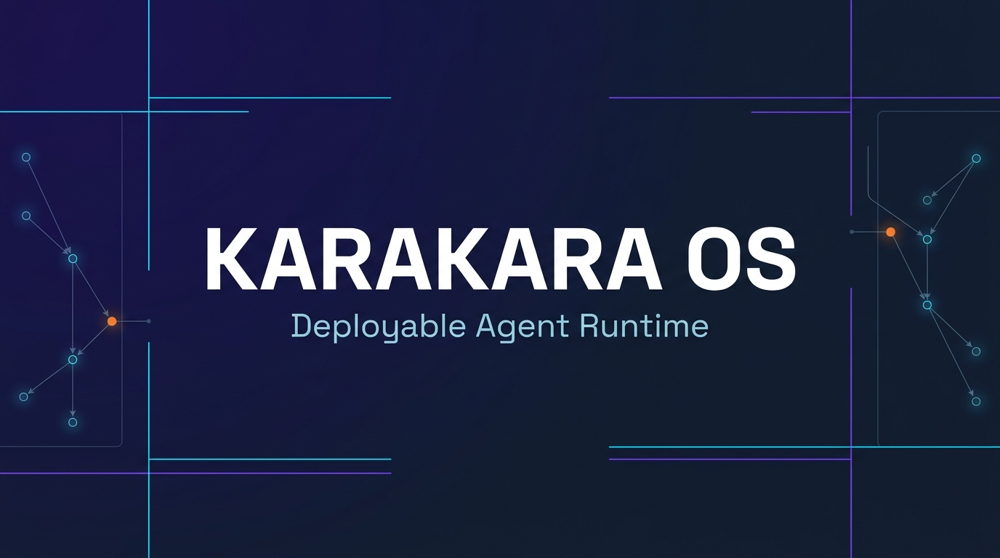
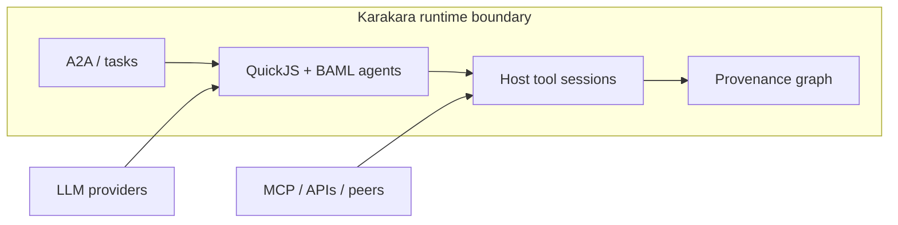

# Karakara OS

Karakara OS is a **deployable agent runtime** for AI systems that take real
actions — tools, MCP servers, other agents, multi-turn tasks — while the **host
stays in control of every effect**. Agents are authored in
[BAML](https://github.com/BoundaryML/baml) and TypeScript, executed in an
embedded QuickJS sandbox, and served over the
[A2A](https://google.github.io/A2A/) protocol. What happened is recorded in a
**graph-native provenance store** you can query after the fact.

---

## The proposition

- **Runtime, not framework.** Deploy and operate a boundary around planning, execution, A2A, and observability — not a library you embed and hope agents behave.
- **Host-mediated effects.** Tool calls (HTTP, MCP, inter-agent delegation) run in **Rust on the host** via a session FSM. JavaScript never mediates host tool execution.
- **Declarative agent artefacts.** The shareable unit is a **content-addressable bundle** (manifest, TypeScript, BAML) executed by the trusted runtime.
- **Planning and outcomes are runtime concepts.** Tasks, plans, steps, tool-session phases, citations, and `StructuredReply` are enforced by the platform.
- **Graph-first provenance.** Conversation context, exports, and drift reads **traverse edges** in the provenance graph — never string hacks on node IDs or timestamps.
- **Cluster continuity.** In multi-runner deployments, router-held conversation state, shared SurrealDB, and deployment APIs provide operational continuity; durable truth lives in the graph.



Expanded thesis: [`docs/assertions/karakara-runtime-thesis.md`](docs/assertions/karakara-runtime-thesis.md)

---

## Quick start

- **Prebuilt Linux binaries (`karak`):** [`INSTALL.md`](INSTALL.md)
- **Build from source, demos, tests & observability:** [`docs/runbooks/getting-started.md`](docs/runbooks/getting-started.md)

```bash
just check-host && just build-release   # build karakara from source
just runner                             # HTTP A2A on http://127.0.0.1:18080
```

---

## Documentation

| Audience | Start here |
|----------|------------|
| Getting started (source, demos, tests) | [`docs/runbooks/getting-started.md`](docs/runbooks/getting-started.md) |
| Installing prebuilt binaries | [`INSTALL.md`](INSTALL.md) |
| Agent authors | [`docs/assertions/how-to-write-agents.md`](docs/assertions/how-to-write-agents.md) |
| Runtime thesis | [`docs/assertions/karakara-runtime-thesis.md`](docs/assertions/karakara-runtime-thesis.md) |
| Full documentation index | [`docs/README.md`](docs/README.md) |
| Contributing | [`CONTRIBUTING.md`](CONTRIBUTING.md) |

## License

Apache License 2.0 — see [`LICENSE`](LICENSE) and [`NOTICE`](NOTICE).
