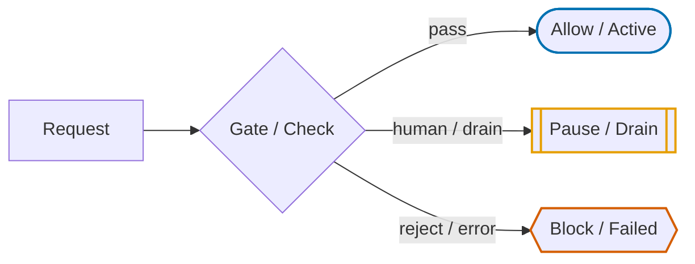

<!-- doc-type: assertion -->

# Accessibility & Diagram Standards

Normative accessibility standards for Karakara OS documentation, visual diagrams, and future user-facing surfaces (`web/`, `karak` CLI, and agent outputs).

---

## 1. Documentation Diagrams (Mermaid)

All architecture, sequence, flow, state, and topology diagrams in `docs/` MUST use fenced ```` ```mermaid ```` blocks rather than ASCII box art. Plain-text trees are reserved for directory/file listings.

### Colorblind-Safe & Theme-Native Rendering

Diagrams must remain legible under deuteranopia, protanopia, tritanopia, monochrome rendering, and both **GitHub Light and Dark modes**:

- **Theme-native fills only:** Do not hardcode light/dark background `fill` colors. Let Mermaid/GitHub pick theme-native node backgrounds and text contrast.
- **Never encode meaning by color alone:** Every status, boundary, or branch must be distinguishable through **shape, line style, and explicit text labels**.
- **Redundant shape encoding:**
  - Stadium `(["..."])` — healthy terminal, allow, or active state (e.g., `Allow`, `Active`)
  - Double-bordered `[["..."]]` — pause, human-in-the-loop, or draining state (e.g., `RequireAuthorization`, `Draining`)
  - Hexagon `{{"..."}}` — block, failure, or error state (e.g., `Block`, `Failed`, `412`)
  - Cylinder `[("...")]` — persistent storage or database (e.g., `SurrealDB`, `Repository`)
  - Diamond `{"..."}` — decision or verification gate
- **Edge semantics:** Use solid arrows (`-->`) for primary control/data flow, dotted arrows (`-.->`) for async/observability side effects, and explicit edge labels on every branch.
- **Okabe–Ito stroke-only accents (optional):** When visual emphasis helps scan outcomes, use `stroke-width:2px` with Okabe–Ito colorblind-safe strokes only:
  - `#0072B2` (blue) — allow / active / storage
  - `#E69F00` (orange) — pause / human authorization / draining
  - `#D55E00` (vermilion) — block / fail / error



### Codebase Accuracy

Every diagram added or updated must be validated against the current codebase (routes, crate/module names, CLI flags, structs/enums, and limits) in the same PR.

---

## 2. Future Surfaces (Reserved Scope)

As Karakara OS evolves, this document is the single home for accessibility invariants across:

- **Web UI (`web/`):** Keyboard navigation, focus management, ARIA semantics, contrast ratios, and non-color-only status indicators.
- **CLI (`karak`):** Screen-reader-friendly output, `NO_COLOR` support, and clear non-color status prefixes.
