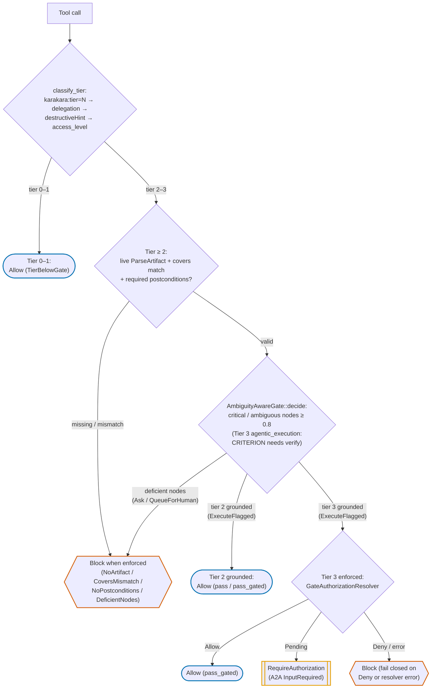

# Karakara Gate

Deterministic pre-action grounding for consequential tool calls. The LLM produces a
`ParseArtifact`; host code classifies tier and runs the P4 ambiguity-aware gate.

## Sign taxonomy (Peirce + verify)

| Sign | Weight | Meaning |
|------|--------|---------|
| symbol | 0.3 | Convention only — words constrain nothing about referent |
| index | 0.8 | Existential pin (path, URI, prod id) |
| icon | 0.9 | Structural exhibit (schema, predicate) |
| verify | 1.0 | Falsifiable postcondition |
| free | 1.0 | Unrestricted anchor |

Trojan veto: symbol-only anchor on a trojan-flagged node counts as strength 0.0 unless
icon/index/verify is also present.

## Templates and critical nodes

| Template | Critical nodes |
|----------|----------------|
| agentic_execution | ACTION, TARGET, SCOPE |
| delegation | CRITERIA, GOAL |
| code_generation | BEHAVIOR, INTERFACE |
| consequential_content | AUDIENCE, OBJECTIVE, FACTS |
| research | SUBJECT, SCOPE |

## Tier classification (declared)

Defaults from tool metadata `access_level` (`crates/baml-rt-karakara/src/tier.rs`):

- `read` → tier 0 (`Tier::Read`)
- `write` → tier 2 (`Tier::Mutating`)
- `delete` → tier 3 (`Tier::Irreversible`)

Precedence in `classify_tier`:
1. Tag `karakara:tier=N` (`0..=3`) overrides everything else.
2. Delegation calls (`is_delegation = true`) classify as tier 2 (`Tier::Mutating`).
3. MCP `destructiveHint == true` classifies as tier 3 (`Tier::Irreversible`). (`readOnlyHint` never lowers a declared tier.)
4. Otherwise falls back to `access_level`.

Tier 0–1: pass through. Tier ≥ 2: requires a live `ParseArtifact` (30-minute TTL) whose `covers` match the tool name and args, plus non-empty `postconditions` (unless tier 3 with `requirePostconditionsT3=false`). Tier 3 grounded pass when enforced: human authorization via `GateAuthorizationResolver` (`Pending` suspends via A2A `InputRequired`; resolver errors fail closed to deny).

## P4 ambiguity-aware gate

A node needs strength ≥0.8 at tier≥2 (0.3 at tier 1) iff it is **critical for its
template OR visibly ambiguous** (trojan flag, or >1 interpretation). Non-ambiguous
supporting nodes have floor 0. Tier 3 on `agentic_execution` additionally requires `verify`
on `CRITERION` when that node exists.

`GateAction` variants (`crates/baml-rt-karakara/src/gate.rs`): `execute` (tier ≤ 1 grounded), `execute_flagged` (tier ≥ 2 grounded), `ask` (tier ≤ 2 deficient), `queue_for_human` (tier 3 deficient).

## Multi-agent invariants

- Artifacts scoped to `(agent_id, task_id)` — never inherited across delegation
- Read-only exploration manifests never reach tier≥2 gate
- Grounding does not delegate: sub-agents return proposals; orchestrator grounds

## Configuration

Runtime gate policy lives in the **config store** bundle `karakara` — same mechanism as
LLM clients (`GET/PUT /config/karakara`). Operators edit it in **Settings → Trust**;
changes hot-reload without restart.

**System default** applies to all agents. **Per-agent overrides** are keyed by
`agent_package` (discovered from `GET /agents`), matching LLM routing.

Default: `enabled=false`, `mode=dry_run`, `enforceMinTier=2`, `requirePostconditionsT3=true`.

## Failure posture

Tier-3 authorization resolver errors fail closed to `Deny` (`InterceptorDecision::Block`), never silent allow of an irreversible tool call.

## Telemetry (structure-only v1)

`gate_decision`, `prevented_error`, `friction_denial`, `postcondition_result`, `prompt_lint`.
Friction denials (denied call re-executed unchanged) tune false-positive cost.

## Citation integrity (compatibility note)

Post-LLM `LlmCompleted` citation auditing was removed from the completion hot path (see [`citable-history-and-checked-citations.md`](citable-history-and-checked-citations.md)). `strictCitationAnchors` on `KarakaraPolicy` and the types in `crates/baml-rt-karakara/src/integrity.rs` remain only for config and historic provenance decoding compatibility.

Implementation: [`crates/baml-rt-karakara`](../../crates/baml-rt-karakara).
