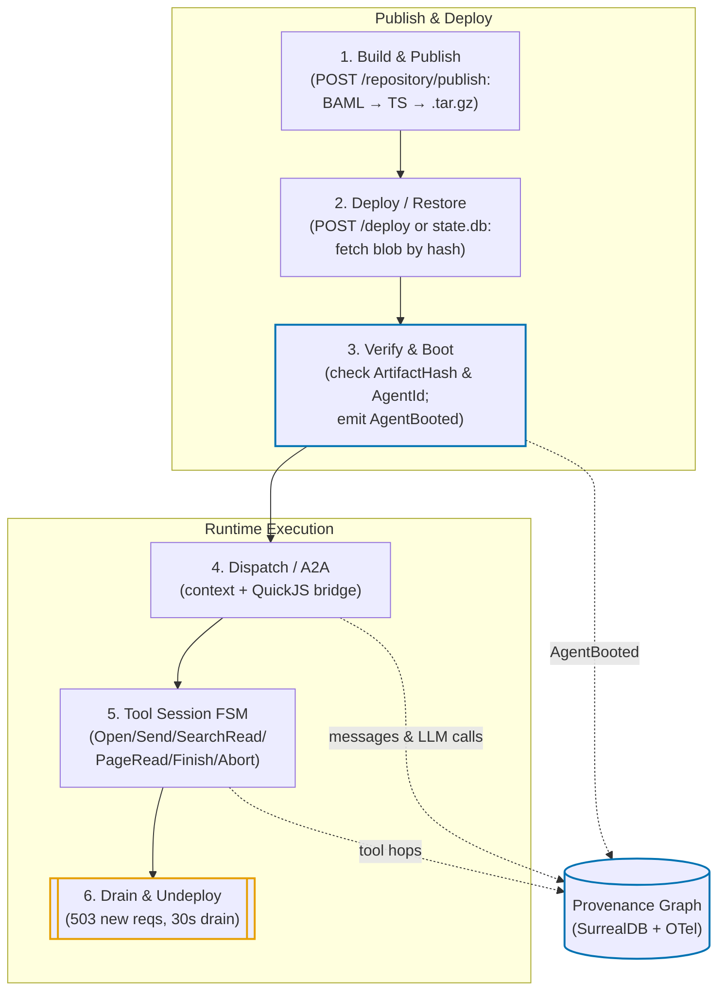

# Agent Runner Reference

The `baml-agent-runner` crate provides the core A2A (Agent-to-Agent) host library that powers the Karakara OS runtime. It's instantiated via `karak serve` and handles agent lifecycle, conversation management, and tool execution.

## Configuration

### Provenance Drift Flag (Opt-in)

Provenance drift scoring is opt-in on `RunnerConfig` (`crates/baml-agent-runner/src/config.rs`) and disabled by default:

```rust
// crates/baml-agent-runner/src/config.rs
pub(crate) struct RunnerConfig {
    pub(crate) repository_url: String,
    pub(crate) repository_dir: PathBuf,
    pub(crate) state_dir: PathBuf,
    pub(crate) provenance_db: ProvenanceDb,
    pub(crate) provenance_drift_enabled: bool, // Default: false
    // ...
}
```

`provenance_drift_enabled` turns `true` only when `--enable-provenance-drift` is passed to `karak serve` or a non-empty `BAML_MODELS_DIR` environment variable is set (the in-runner embedding drift consumer is currently reserved/inactive while the CLI and `BAML_MODELS_DIR` wiring remain in place; see [`drift-catalogue.md`](../assertions/drift-catalogue.md)).

## Core Components

### HTTP & A2A Surface

The runner mounts `baml-rt-api`, exposing public discovery/A2A/provenance routes alongside operator-authenticated lifecycle and configuration routes (`X-Runner-Token` in cluster mode).

**Key public endpoints:**
- `GET /agents` - Agent discovery (one entry per active deployed package)
- `POST /agents/{agent_package}/a2a` - A2A JSON-RPC with SSE streaming
- `POST /agents/{agent_package}/dispatch` - Deterministic host-to-agent event delivery
- `POST /events/publish` - Host source-records intake (`host.source-records.v1`)
- `GET /contexts` - Conversation context index
- `GET /contexts/{context_id}/conversation-history` (and `/stream`) - Projected conversation history
- `GET /contexts/{context_id}/episode` (and `/text`, `/stream`) - Episode snapshot and stream

**Key operator endpoints (`X-Runner-Token` in cluster mode):**
- `POST /deploy`, `POST /undeploy`, `GET /deployments` - Runner-local deployment lifecycle
- `GET /cluster/agents`, `POST /cluster/deploy` - Cluster-wide views and placement
- `GET/PUT/DELETE /config/{bundle}` - Runtime configuration bundles (LLM routing, `karakara` gate, etc.)
- `POST /repository/publish`, `POST /repository/fork` - Build and publish agent packages into `/repository`

### Tool Session Management

Tools follow a finite state machine with these operations:
- **Open** - Initialize tool session
- **Send** - Execute tool with parameters
- **SearchRead** - Query tool results
- **PageRead** - Paginated result access
- **Finish** - Clean tool termination
- **Abort** - Force tool cleanup

### Cluster Mode

Cluster mode is activated by providing `--surreal-endpoint` (not `RUNNER_TOKEN` alone). In cluster mode:
- Shared SurrealDB instance for conversation persistence
- Distributed agent execution across multiple runner instances
- Consistent conversation state via graph database

### Provenance Integration

The runner integrates with `baml-rt-provenance` for conversation tracking:
- **Effect subscription**: Captures all conversation events
- **Graph persistence**: Stores conversation history in SurrealDB
- **Drift detection**: Optional embedding-based conversation drift scoring
- **Metrics emission**: OpenTelemetry metrics for conversation analytics

## Runtime Behavior

### Agent Identity

The runner derives a stable `AgentId` from the extracted package before building
the agent bridge. The identity digest covers the behavior-defining content
(manifest projection, authored TypeScript, BAML prompts and generated prelude,
tool-schema catalog, and session-plan dispatch table) and ignores repository
version, compiled `dist/**`, and package framing.

- The same packaged content keeps its `AgentId` across boots, replicas, and
  relocations.
- A behavior-defining source change produces a new `AgentId`.
- The `ArtifactHash` identifies the exact stored `.tar.gz` bytes. Two artifacts
  can share an `AgentId` and still execute different compiled output.

Boot verifies both values. A mismatch between the supplied `AgentId` or
`ArtifactHash` and the extracted package fails before the agent starts serving.
The `AgentBooted` event records the real process identity, not a placeholder.
Task execution carries that boot event ID explicitly, so provenance links a task
to the process lifetime and artifact that actually executed it. Ops rows resolve
`agent_version` only through that exact boot-to-artifact path; rows with no such
path omit the version and display the package alone. Startup restore also verifies
the persisted deployment artifact hash against the repository entry before
booting.

Cluster placements require an artifact hash. Forwarded A2A requests carry
`X-Karakara-Expected-Artifact-Hash`; the receiving runner compares it with the
exact `BootedAgent` selected for dispatch before creating a task, and returns
`412 Precondition Failed` on mismatch.
`AutoGenerate` identity is limited to ephemeral tests and development agents;
production boot paths pass the identity explicitly.

### Agent Lifecycle



1. **Build & Publish**: `karak install agent` or `POST /repository/publish` compiles BAML and TypeScript into an immutable `.tar.gz` artifact and records `content_hash`, `artifact_hash`, and `identity_digest` (`karak serve` never accepts raw positional agent directories).
2. **Deploy / Startup Restore**: `POST /deploy` (or startup replay from `--state-dir/state.db`) pulls the stored artifact from `--repository-url`.
3. **Identity Verification & Boot**: Verify `ArtifactHash` and derived `AgentId` before serving, initialize the QuickJS runtime bridge, and emit `AgentBooted`.
4. **Dispatch / A2A Execution**: Route `POST /agents/{agent_package}/a2a` and `/dispatch` calls into conversation contexts.
5. **Tool Session Execution**: Mediate host, MCP, and external tools in Rust via the session FSM (`Open`, `Send`, `SearchRead`, `PageRead`, `Finish`, `Abort`).
6. **Drain & Undeploy**: On `POST /undeploy`, mark the deployment draining (`503` to new requests, up to `30s` drain timeout) and update local state.

### Error Handling

- **Tool failures**: Isolated per tool session, don't crash conversation
- **Agent crashes**: Captured and reported via conversation events
- **Network issues**: Retry logic for external tool calls
- **Resource limits**: Memory and execution time bounds enforced

### Performance Characteristics

- **Concurrent conversations**: Multiple conversations per runner instance
- **Tool parallelism**: Tools can execute concurrently within a conversation
- **Memory management**: QuickJS heap limits and garbage collection
- **Connection pooling**: Reused HTTP clients for external services

## Integration Points

### With baml-rt-api

The runner is embedded in the HTTP API layer (`baml-rt-api`) which provides:
- REST endpoints for conversation management
- Authentication and authorization middleware
- Request/response serialization
- Error response formatting

### With baml-rt-tools

Tool integration happens through:
- **Tool registry**: Dynamic tool discovery and instantiation
- **Session management**: Tool lifecycle coordination
- **MCP support**: Model Context Protocol tool providers
- **Host tools**: Built-in system tools (filesystem, network, etc.)

### With baml-rt-provenance

Provenance tracking provides:
- **Event capture**: All conversation events stored in graph database
- **Relationship modeling**: Conversations, messages, tool calls as graph nodes
- **Query capabilities**: Graph traversal for conversation analysis
- **Drift scoring**: Optional embedding-based conversation similarity

## Configuration Reference

### Environment Variables

- `RUNNER_TOKEN`: Shared secret for operator-authenticated HTTP routes (`X-Runner-Token`)
- `SURREAL_USER` / `SURREAL_PASS`: Credentials for `--surreal-endpoint` (all-or-nothing)
- `RUNNER_ENDPOINT`: Public URL this runner advertises in cluster placements (`--runner-endpoint`)
- `PLACEMENT_TTL_MS`: Cluster placement heartbeat TTL in milliseconds (default: `90000`)
- `BAML_RUNNER_CONFIG`: Path to `runner.toml` (`--runner-config`)
- `BAML_MODELS_DIR`: Local model directory (non-empty value also enables `provenance_drift_enabled`)
- `RUST_LOG` / `RUST_LOG_FMT` / `RUST_LOG_OTEL`: Console and OpenTelemetry tracing filters

### Config Files

Secrets live in `.env` or `fnox.toml` (resolved via `baml-rt-llm-config`), while optional datasource/webhook directories live in `runner.toml`:

```toml
# runner.toml (passed via --runner-config or BAML_RUNNER_CONFIG)
[external_tools]
dirs = ["./operations/datasources"]

[external_datasources.grafana.prod]
enabled = true
```

### Command Line Options

```bash
karak serve \
  --serve-http 127.0.0.1:18080 \
  --repository-dir ./.repository \
  --repository-url http://127.0.0.1:18080/repository \
  --state-dir ./.runner-state \
  --provenance-db ./.provenance \
  --web-dir ./web/dist
```

For cluster mode with remote SurrealDB:

```bash
karak serve \
  --serve-http 0.0.0.0:18080 \
  --surreal-endpoint ws://surrealdb:8000 \
  --runner-endpoint http://runner-0:18080 \
  --runner-token "$RUNNER_TOKEN"
```

## Debugging and Observability

### Logging

Structured logging with tracing spans (`crates/baml-rt-observability`):
- `context_id` / `task_id` / `message_id`: Correlates events across an A2A turn
- `agent_package` / `agent_instance_id`: Identifies which deployed agent instance is executing

### Metrics

OpenTelemetry metrics are exported via OTLP (`baml_rt_api.http.*`, `baml_rt.*`, `baml_rt_provenance.*`, etc.). See [`metrics-inventory.md`](metrics-inventory.md) for the complete workspace metric catalog.

### Health & Diagnostic Endpoints

- `GET /healthz`: Liveness probe
- `GET /readyz`: Readiness probe (including backing store readiness)
- `GET /diagnose`: Runtime diagnostic summary
- `GET /openapi.json`: Merged OpenAPI 3.1 specification
