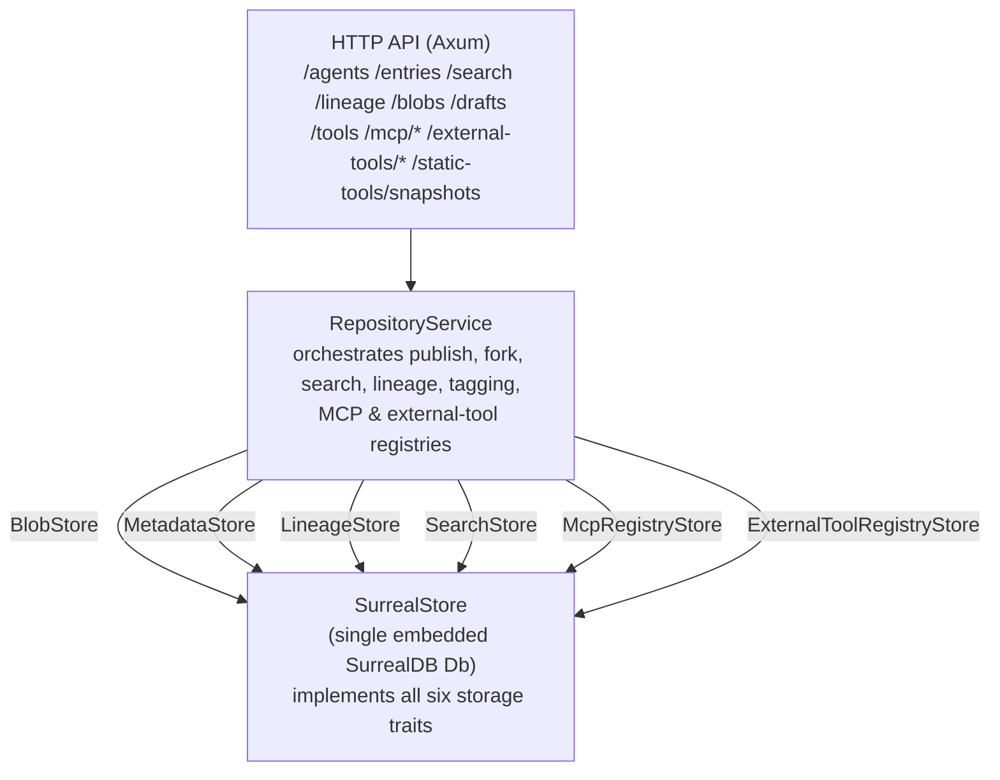
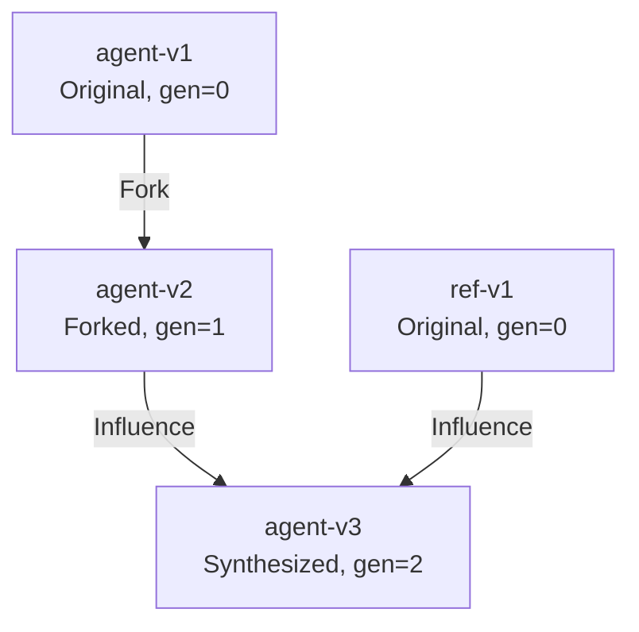
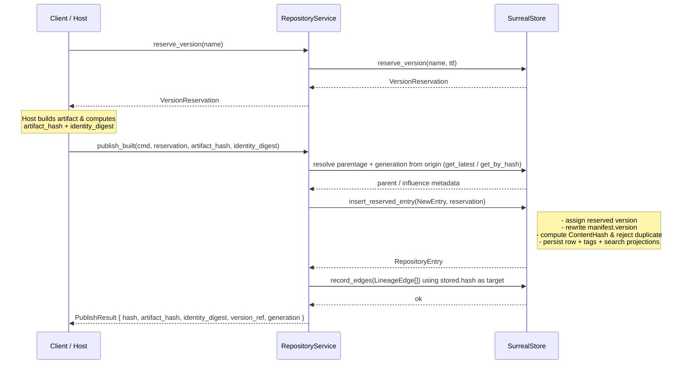

# baml-rt-hash & baml-rt-repository — Design Document

Two crates that give Karakara OS a **content-addressable package repository** with lineage tracking, versioning, and search.

- **`baml-rt-hash`** — standalone canonical hashing (SHA-256 over a length-delimited section format with deterministic JSON key ordering). Depends only on `sha2`, `serde_json`, `thiserror`.
- **`baml-rt-repository`** — SurrealDB-backed repository: publish, fork, search, lineage DAG, tagging, and an Axum HTTP API.

---

## Design Intent

The repository is the **memory layer** for an agent development and selection (ADAS) loop. Agents are treated as immutable, content-addressed artefacts. Every mutation (manual edit, LLM-driven rewrite, automated fork) produces a new entry linked to its predecessors via typed lineage edges. This enables:

1. **Deterministic content identity** — same authored source ⇒ same content hash, regardless of build artefacts. The behavior-set digest and artifact hash are separate values; see [Three identities](#three-identities).
2. **Provenance** — full derivation history via fork/influence DAG.
3. **Selection pressure** — tags and lineage relationships let meta-agents query "what was derived from this?" or "what influenced that?".
4. **Distribution** — pull by hash (exact) or `name@version` (human-friendly).

---

## Architecture



Release-producing `/publish` and `/fork` are host routes: this crate cannot build artifacts, so it exposes source-only `/drafts` and `/drafts/fork` instead.

### Single Backend, Trait-Separated Surface

The repository keeps six storage traits separated at the type level:

| Trait | Concern |
|---|---|
| `BlobStore` | Distributable tar.gz packages and `.ktool` bundles keyed by content/artifact hash |
| `MetadataStore` | Entry/version metadata, version reservations, tag CRUD, version-ref resolution |
| `LineageStore` | Edge recording and DAG traversal |
| `SearchStore` | Structured queries with text, tag, capability, tool, generation, and lineage filters |
| `McpRegistryStore` | Approved MCP server snapshots, versions, and tool lookup |
| `ExternalToolRegistryStore` | Approved external-tool snapshots, versions, and staleness tracking |

A single concrete backend, `SurrealStore`, implements all six. The traits exist for testability and so that future deployments can swap individual concerns without rewriting the service layer.

---

## Canonical Hash (baml-rt-hash)

```
SHA-256(
  section("manifest", canonical_json(manifest.json))
  ‖ for each .ts file sorted by path:
      section("ts", path ‖ content)
  ‖ for each .baml file sorted by path:
      section("baml", path ‖ content)
)

section(tag, data) = tag_len:u32le ‖ tag ‖ data_len:u64le ‖ data
```

Only **authored source** is hashed — runtime artefacts (`*.d.ts`, `tsconfig.json`, compiled JS, `baml_client/`) are excluded. Two packages with identical authored source always produce identical hashes.

The hash is a standalone crate so other crates (the builder, the runner, future ADAS tooling) can compute hashes without depending on SurrealDB or Axum.

### Three identities

The same crate owns three distinct values:

| Value | Input | Use |
| --- | --- | --- |
| `ContentHash` | Versioned manifest + canonical source bundle | Repository entry and version lineage |
| `AgentIdentityDigest` | Behavior-defining packaged content | Derives the stable `AgentId` |
| `ArtifactHash` | Exact stored `.tar.gz` bytes | Blob key and deployment audit |

The behavior set behind `AgentIdentityDigest` is a fixed, path-sorted list of
`(relative path, SHA-256 of file bytes)` entries: the manifest projection
without `version` or `signature`; authored `src/**/*.ts` excluding `*.d.ts`;
authored and generated `baml_src/**/*.baml`; the rendered
`baml_src/_baml_tool_schema_catalog.txt`; and `session_plan_functions.json`.
Neither the repository version nor compiled `dist/**` output is included, so
republishing identical content and toolchain-only rebuilds keep the same
identity.

`AgentId` is `UUIDv5(KARAKARA_AGENT_NAMESPACE, "urn:karakara:agent-id:" + digest)`.
`ArtifactHash` covers the stored blob, so two artifacts can share one `AgentId`
while shipping different executable bytes.

---

## Storage Layout

`SurrealStore` opens an embedded SurrealDB instance under namespace `baml`, database `repository`. Two open modes:

- **Persistent** — `SurrealStore::open(path)` uses the `SurrealKv` engine; data is stored on disk under the given path.
- **In-memory** — `SurrealStore::open_in_memory()` uses the `Mem` engine; suitable for tests and short-lived processes.

Schema is initialised idempotently on every open via `DEFINE TABLE IF NOT EXISTS` / `DEFINE FIELD IF NOT EXISTS` / `DEFINE INDEX IF NOT EXISTS` statements.

### Tables

The statements below show structure only. The actual `init_schema` call wraps every `DEFINE TABLE` / `DEFINE FIELD` / `DEFINE INDEX` with `IF NOT EXISTS` so reopens are safe.

```surql
DEFINE TABLE entries SCHEMAFULL;
DEFINE FIELD hash                       ON entries TYPE string;
DEFINE FIELD agent_name                 ON entries TYPE string;
DEFINE FIELD version                    ON entries TYPE int;
DEFINE FIELD generation                 ON entries TYPE int;
DEFINE FIELD parentage_json             ON entries TYPE string;     -- Parentage as JSON
DEFINE FIELD source_json                ON entries TYPE string;     -- SourceBundle as JSON
DEFINE FIELD change_rationale           ON entries TYPE string;
DEFINE FIELD created_at                 ON entries TYPE string;
DEFINE FIELD manifest_description       ON entries TYPE option<string>;
DEFINE FIELD manifest_tools_json        ON entries TYPE string;     -- Vec<String>
DEFINE FIELD manifest_capabilities_json ON entries TYPE string;     -- Vec<String>
DEFINE FIELD manifest_text              ON entries TYPE string;     -- searchable manifest projection
DEFINE FIELD source_text                ON entries TYPE string;     -- searchable source projection
DEFINE FIELD artifact_hash              ON entries TYPE option<string>;
DEFINE FIELD identity_digest            ON entries TYPE option<string>;
DEFINE INDEX idx_entries_hash         ON entries FIELDS hash UNIQUE;
DEFINE INDEX idx_entries_name_version ON entries FIELDS agent_name, version UNIQUE;

DEFINE TABLE tags SCHEMAFULL;
DEFINE FIELD entry_hash ON tags TYPE string;
DEFINE FIELD tag        ON tags TYPE string;
DEFINE INDEX idx_tag_unique ON tags FIELDS entry_hash, tag UNIQUE;
DEFINE INDEX idx_tag_lookup ON tags FIELDS tag;

DEFINE TABLE lineage_edges SCHEMAFULL;
DEFINE FIELD id          ON lineage_edges TYPE string;
DEFINE FIELD source_hash ON lineage_edges TYPE string;
DEFINE FIELD target_hash ON lineage_edges TYPE string;
DEFINE FIELD kind        ON lineage_edges TYPE string;              -- 'fork' | 'influence'
DEFINE FIELD description ON lineage_edges TYPE string;
DEFINE INDEX idx_edge_id     ON lineage_edges FIELDS id UNIQUE;
DEFINE INDEX idx_edge_source ON lineage_edges FIELDS source_hash;
DEFINE INDEX idx_edge_target ON lineage_edges FIELDS target_hash;

DEFINE TABLE blobs SCHEMAFULL;
DEFINE FIELD hash     ON blobs TYPE string;                         -- artifact or .ktool hash
DEFINE FIELD data_hex ON blobs TYPE string;                         -- hex-encoded bytes
DEFINE INDEX idx_blob_hash ON blobs FIELDS hash UNIQUE;
```

In addition to these four core tables, `SurrealStore` defines `entry_version_reservations` (TTL-bounded version reservations held while a host builds an artifact), `mcp_servers` / `mcp_server_versions` / `mcp_tool_versions` / `mcp_snapshot_blobs` (for `McpRegistryStore`), and `external_tools` / `external_tool_versions` / `external_tool_approvals` / `external_tool_snapshot_blobs` (for `ExternalToolRegistryStore`).

### Why a single SurrealDB backend?

- **One process, one storage primitive.** The runner already embeds SurrealDB for provenance; sharing the engine for repository state simplifies operations and removes a second persistence dependency.
- **Blobs live in the database.** Tar.gz bytes are stored as hex-encoded strings in the `blobs` table rather than on the host filesystem. Pull and deploy paths are pure database reads, which keeps the repository portable across container restarts and pod replacements without a separately mounted volume.
- **Search projections are precomputed.** Filterable fields (`manifest_tools_json`, `manifest_capabilities_json`) and the searchable text projections (`manifest_text`, `source_text`) are written at insert time so reads are simple field lookups.
- **DAG traversal happens in Rust.** Lineage queries load edges from `lineage_edges` and walk the graph in-process via BFS over an adjacency map. SurrealDB's native graph features are not currently used.

---

## Lineage DAG



### Edge Kinds

| Kind | Meaning | Cardinality |
|---|---|---|
| **Fork** | Hard derivation — "this was created by mutating that" | Single parent |
| **Influence** | Soft reference — "this was informed by those" | Zero or more |

Generation is determined by the publish command, not by the edge kind. See [Generation](#generation-is-computed-not-declared) for the per-command rule.

### Parentage (discriminated union)

```rust
enum Parentage {
    Original,                                                       // no parent — first in lineage
    Forked      { parent: ContentHash, description: EdgeDescription },
    Synthesized { influences: Vec<InfluenceRef> },                  // one or more soft references
}
```

Fork and influence are structurally distinct so the graph can answer different questions: "what was directly derived?" vs "what references informed this design?".

### Traversal

`LineageStore` exposes `parents`, `children`, `ancestors(max_depth)`, `influenced_by`, and `subgraph(ancestor_depth)`. The `SurrealStore` implementation loads the full edge set, builds forward and reverse adjacency maps, and executes a depth-bounded BFS in Rust.

---

## Versioning

```
weather-agent@1  →  ContentHash("a1b2c3…")
weather-agent@2  →  ContentHash("d4e5f6…")
weather-agent@3  →  ContentHash("789abc…")
```

- **Monotonic per-agent**: versions start at 1 and increment within a named lineage.
- **`VersionRef = AgentName + Version`** — human-addressable (`weather-agent@2`).
- **`ContentHash`** — machine-addressable (exact, immutable).
- **Generation** tracks fork-depth from the lineage root and is independent of version number.

### Repository-assigned versions are part of the hash input

`MetadataStore::reserve_version` + `MetadataStore::insert_reserved_entry` is the canonical publish write path (`MetadataStore::insert_entry` performs the same steps directly for unreserved fork drafts):

1. Reserve (or look up) the next monotonic `version` for `agent_name`: `prev + 1`, or `1` for a new lineage.
2. Rewrite `manifest.version` to that next version (`SourceBundle::with_manifest_version`).
3. Compute the canonical content hash from the versioned source bundle.
   The behavior-set identity digest and artifact hash are derived separately and
   written on the same entry; they are not part of the content hash.
4. Reject the insert with `RepositoryError::DuplicateHash` if another entry already carries this hash.
5. Persist the row, including the precomputed `manifest_text` / `source_text` search projections.

Hashing the version-stamped manifest means the published `ContentHash` is determined by the repository, not by whatever version string the client supplied. Builders can leave `manifest.version` blank (or stale) and trust the repository to make it canonical.

---

## Search

```rust
SearchQuery {
    text:         Option<FullTextTerm>,            // case-insensitive substring
    name:         Option<AgentName>,               // exact name match
    capabilities: Vec<CapabilityFilter>,           // manifest.capabilities (all required)
    tools:        Vec<ToolFilter>,                 // manifest.tools         (all required)
    tags:         Vec<TagFilter>,                  // entry tags             (all required)
    generation:   Option<GenerationFilter>,        // min/max fork-depth
    lineage:      Option<LineageFilter>,           // descendants/ancestors of a hash
    limit:        Option<usize>,
    order:        SearchOrder,                     // Newest | Oldest | Relevance
}
```

`SearchStore::search` executes filters in-process: it loads candidate rows from `entries`, filters them through `manifest_text` / `source_text` for the optional text term, hydrates each surviving row into a `RepositoryEntryHeader`, applies the metadata filters, then orders and limits the result set. Lineage filters reuse the in-memory adjacency map described in [Traversal](#traversal).

`SearchOrder::Relevance` currently falls back to newest-first ordering.

---

## HTTP Endpoints

### Router composition

`baml-rt-repository` exposes router builders for the routes it can serve without a builder:

| Builder | Routes | Intended use |
|---|---|---|
| `repository_router(service)` | All read + mutation routes below, no release publish/fork | Standalone or embedded repository use |
| `repository_router_without_publish(service)` | Compatibility alias with the same release-free surface | Hosts that wire publish/fork themselves |
| `repository_read_router(service)` | Read-only routes (agents, versions, entries, lineage, blobs, search, tools, MCP & external-tool catalogs) | Mount unauthenticated for public discovery and pull |
| `repository_mutation_router(service)` | `POST /drafts`, `POST /drafts/fork`, tag CRUD, MCP & external-tool snapshot publish/import/staleness | Mount behind operator authentication |

The host application mounts `/repository/publish` and `/repository/fork` to `repository_publish::publish_with_build` / `fork_with_build`. Both build a package, compute `artifact_hash` and `identity_digest`, and only then insert the entry.

The split read/mutation routers reflect how `baml-agent-runner` exposes the repository in cluster mode: the read router is reachable without credentials, and the mutation router (plus the runner's own `/deploy`) sits behind the runner token.

### Routes

| Method | Path | Description |
|---|---|---|
| `GET` | `/agents` | List all agent names |
| `GET` | `/agents/{name}/versions` | List versions for an agent |
| `GET` | `/entries` | List or filter entries by `name`/`name+version` query parameters |
| `GET` | `/entries/{hash}` | Retrieve an entry by content hash |
| `GET` | `/entries/{name}/{version}` | Retrieve an entry by `name@version` |
| `POST` | `/drafts` | Create a source-only draft (not deployable) |
| `POST` | `/drafts/fork` | Create a source-only fork draft (not deployable) |
| `POST` | `/search` | Run a structured search query |
| `GET` | `/lineage/{hash}?depth={n}` | Get a lineage subgraph (ancestors + direct descendants) |
| `GET` | `/blobs/{hash}` | Download the tar.gz blob by artifact hash |
| `POST` | `/entries/{hash}/tags` | Add a tag |
| `DELETE` | `/entries/{hash}/tags` | Remove a tag |
| `GET` | `/tools`, `/static-tools/snapshots` | List unified or static host tool catalogs |
| `GET` | `/mcp/servers`, `/mcp/servers/{server_id}[/versions[/{version}]]`, `/mcp/tools` | Read approved MCP server snapshots and tool mappings |
| `POST` | `/mcp/snapshots/import`, `/mcp/servers/{server_id}/versions/{version}/mark-stale` | Import MCP snapshots or mark a version stale |
| `GET` | `/external-tools`, `/external-tools/snapshots`, `/external-tools/snapshot`, `/external-tools/versions` | Read external-tool registry snapshots and versions |
| `POST` | `/external-tools/publish`, `/external-tools/service/publish`, `/external-tools/snapshots/import`, `/external-tools/snapshots/mark-stale` | Publish/import external tools or mark a version stale |

Host-only release routes: `POST /repository/publish` and `POST /repository/fork` build before storing and always return an artifact hash plus identity digest. All errors use RFC 7807 Problem Details via `http-api-problem`.

### Publish Flow



---

## Crate Map

```
baml-rt-hash/
├── agent_identity.rs  AgentIdentityDigest + behavior-set hashing
├── artifact_hash.rs   ArtifactHash newtype over stored .tar.gz bytes
├── content_hash.rs    ContentHash newtype (validated SHA-256 hex-64)
├── hasher.rs          CanonicalHasher, HashInput, canonical_json()
└── lib.rs             Re-exports

baml-rt-repository/
├── ids.rs             AgentName, Version, Generation, VersionRef, LineageEdgeId
├── identity.rs        Package identity helpers
├── lineage.rs         LineageKind, Parentage, LineageEdge, EdgeDescription,
│                      InfluenceRef, AncestryNode, LineageSubgraph
├── entry.rs           SourceBundle, ManifestSource, RepositoryEntry, VersionReservation,
│                      RepositoryEntryHeader, ChangeRationale, Tag, Timestamp
├── search.rs          SearchQuery, filter newtypes, LineageRelation, SearchOrder
├── commands.rs        PublishCommand, ForkCommand, PublishOrigin, PublishResult, DraftResult
├── dev_artifacts.rs   Generated BAML/TS dev-artifact extraction helpers
├── mcp.rs             MCP server/tool registry domain types
├── external_tool.rs   External-tool registry domain types
├── error.rs           RepositoryError (StorageWrite/Read carry boxed sources)
├── package.rs         tar.gz / on-disk → SourceBundle extraction
├── storage.rs         BlobStore, MetadataStore, LineageStore, SearchStore,
│                      McpRegistryStore, ExternalToolRegistryStore traits
├── surreal_store.rs   SurrealStore — single backend implementing all six traits
├── service.rs         RepositoryService — publish, fork, search, lineage, tagging, registries
├── http.rs            Request/response types, RFC 7807 mappings
├── handlers.rs        Axum handlers for each route
├── router.rs          repository_router, repository_router_without_publish,
│                      repository_read_router, repository_mutation_router
├── spans.rs           OTel span helpers
└── metrics.rs         OTel metric instruments
```

---

## Key Design Decisions

### Hash in its own crate
Builder and runner need to compute hashes without pulling in SurrealDB or Axum. `baml-rt-hash` depends only on `sha2`, `serde_json`, `thiserror`.

### Trait boundaries for storage
`BlobStore`, `MetadataStore`, `LineageStore`, `SearchStore`, `McpRegistryStore`, and `ExternalToolRegistryStore` are async traits even though one struct (`SurrealStore`) implements all six. Keeping the seams visible documents the responsibilities and lets future deployments split or replace any single concern.

### Discriminated unions over flags
`LineageKind::{Fork, Influence}`, `Parentage::{Original, Forked, Synthesized}`, `PublishOrigin::{Original, Iteration, Influenced}` — invalid states are unrepresentable at the type level.

### Generation is computed, not declared
The store never accepts a caller-supplied generation; it is always derived from the publish command:

| Command / origin | Generation of the new entry |
|---|---|
| `PublishOrigin::Original` | `0` (root) |
| `PublishOrigin::Iteration` | Same as the previous version of this lineage (unchanged) |
| `PublishOrigin::Influenced` | `max(influence generations) + 1` |
| `ForkCommand` | Parent's generation `+ 1` |

Iteration creates a Fork-kind edge in the DAG but inherits the predecessor's generation; only an explicit `ForkCommand` advances generation along a Fork edge.

### Version is canonical, not advisory
The repository assigns the next monotonic version, rewrites `manifest.version` to that value, and hashes the result. The published `ContentHash` reflects the repository-assigned version, not anything the client wrote into the manifest beforehand.

### Searchable text is precomputed at insert
The `manifest_text` and `source_text` projections are built in `SurrealStore::insert_entry` from `manifest.{name, version, description, tools, capabilities, tags}` and the concatenated source files, then matched at query time with case-insensitive substring containment. This is intentionally simple; richer ranking (FTS, embeddings) can be layered later without changing the trait.

### Blobs in the database
Storing tar.gz bytes inside SurrealDB removes the need for a separately mounted blob volume and keeps pull semantics independent of host filesystem layout. Bytes are hex-encoded for storage and decoded on read.

---

## Future Work

The following capabilities appear in earlier design notes but are not implemented today:

- **Fitness scoring.** There is no fitness table, no score recording API, and no fitness filter in `SearchQuery`. ADAS-style "best agent for X" selection would need this added before it can be expressed.
- **Native graph traversal.** Replace the in-process BFS with SurrealDB's `RELATE` / graph query syntax once edge volumes warrant pushing traversal into the database.
- **Full-text relevance ranking.** `SearchOrder::Relevance` currently falls back to newest-first. A real relevance score would need either FTS scoring or embedding-based similarity.
