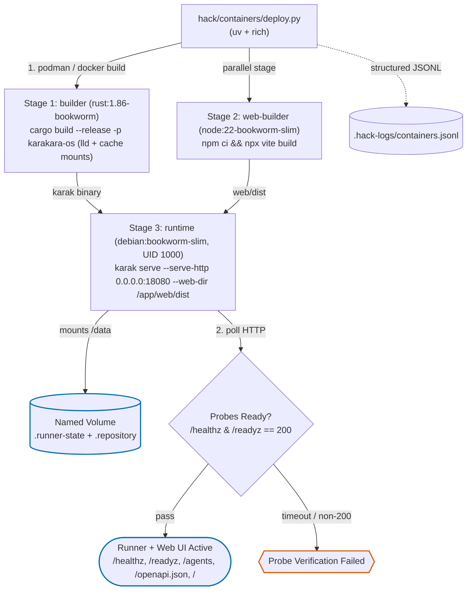

# Local Container Runbook (Podman & Docker)

Run the standalone Karakara OS platform (`karak serve` + built Vue operator Web UI) inside a local OCI container using [`operations/containers/runner.Dockerfile`](../../operations/containers/runner.Dockerfile) and the [`hack/containers/`](../../hack/containers/) developer CLI.

> [!IMPORTANT]
> **Platform Validation Status:** End-to-end container builds, Web UI serving, and `hack/containers/` lifecycle scripts are currently validated on **macOS (`aarch64` Apple Silicon with Podman)**. Native **Linux (`x86_64` and `aarch64`) Docker/Podman validation** is tracked next as follow-up verification.

---

## Architecture & Container Lifecycle

[`runner.Dockerfile`](../../operations/containers/runner.Dockerfile) uses a three-stage build and runs as non-root UID/GID `1000` with `WORKDIR /data` so embedded SurrealKV state (`./.runner-state` and `./.repository`) persists cleanly in a named volume.



---

## VM Resource Sizing (macOS)

Compiling the release Rust workspace (`surrealdb`, `quickjs`, `baml`) inside a Linux VM requires adequate RAM:

| Environment | Recommended Specs | Cold Build Time (`aarch64`) | Notes |
|---|---|---|---|
| Podman (`libkrun`) / Docker Desktop / OrbStack / Colima | `6+ CPUs`, `8–10 GiB` RAM | ~22 min (`cargo build` ~16m, `vite build` ~9s) | Uses `lld` + Cargo registry/git/target cache mounts |
| Constrained VM (`< 8 GiB` RAM) | Pass `--jobs 4` | Slower, lower peak RSS | Passes `--build-arg CARGO_BUILD_JOBS=4` |

---

## Automated Workflow (`hack/containers/`)

Requires [`uv`](https://docs.astral.sh/uv/) and either `podman` or `docker` (auto-detected):

```bash
# Build image, start container on 127.0.0.1:18080, mount /data volume,
# and verify /healthz, /readyz, /agents, /openapi.json, and / (Web UI)
uv run hack/containers/deploy.py

# Reuse built image without rebuilding (optionally pass .env for LLM keys)
uv run hack/containers/deploy.py --skip-build --env-file .env

# Cap Cargo parallelism on memory-constrained VMs
uv run hack/containers/deploy.py --jobs 4

# Stop and remove container (add --purge-volume / --purge-image as needed)
uv run hack/containers/teardown.py --purge-volume
```

---

## Verifying Agents in the Web UI

A fresh container starts with **0 deployed agents** (`existing_deployments=0`), so `http://127.0.0.1:18080` renders an empty agent list until at least one agent is installed.

### 1. Zero-LLM Agent (No API Key Required)
Deploy the pure QuickJS [`stream-js-tool`](../../tests/fixtures/agents/stream-js-tool/src/index.ts) fixture agent to test the full deploy → Web UI → A2A chat loop offline:

```bash
karak install agent \
  --path tests/fixtures/agents/stream-js-tool \
  --repository-url http://127.0.0.1:18080/repository \
  --url http://127.0.0.1:18080
```

Open `http://127.0.0.1:18080`, select `stream-js-tool`, and send a message containing `stream-task`.

### 2. LLM-Backed Product Agents (`agents/*`)
Agents under [`agents/`](../../agents/) (`coordinator-agent`, `notion-agent`, `slack-agent`, `clickup-agent`, `extrospection-agent`) can be deployed and selected without credentials, but executing a chat turn invokes BAML LLM functions and requires provider API keys (such as `OPENROUTER_API_KEY`) supplied via `--env-file .env`.

---

## Related Docs

- [Container Definitions (`operations/containers/README.md`)](../../operations/containers/README.md)
- [Developer Tooling (`hack/README.md`)](../../hack/README.md)
- [Getting Started](getting-started.md)
- [Runner Reference](../reference/agent-runner.md)
