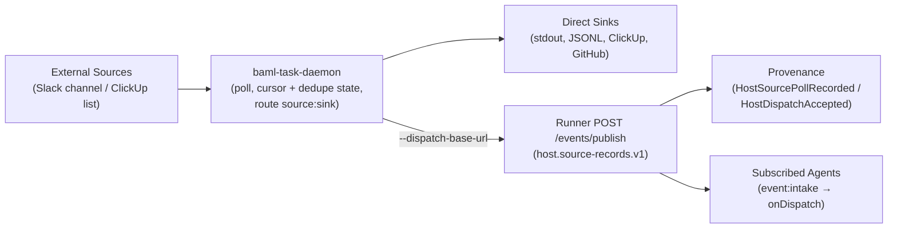

# Task Daemon User Guide

`baml-task-daemon` (`crates/task-daemon`) is a local polling daemon that watches Slack channels and/or ClickUp lists, deduplicates records with persisted cursor state, and publishes raw **`host.source-records.v1`** batches to configured sinks (including the Karakara runner's `POST /events/publish` intake).

Architecturally, task-daemon is a pure **source-records publisher** (in-daemon LLM interpretation and `workflow_seed` extraction were removed; see [`task-daemon-event-contract.md`](../reference/task-daemon-event-contract.md)):

- `baml-task-daemon` polls external sources (`--source slack`, `--source clickup`), tracks cursors and seen keys in `.karakara/task-daemon-state.json`, and emits raw `host.source-records.v1` batches.
- When pointed at a runner (`--dispatch-base-url`), it posts batches to `POST /events/publish`.
- The runner records provenance (`HostSourcePollRecorded`, `HostDispatchAccepted`), matches agent `subscriptions` (`event:intake`), and injects raw `records[]` into each subscribed agent's `onDispatch` conversation context.
- Subscribed agents perform all semantic interpretation and downstream orchestration inside the runtime boundary.



## Core Concepts

- `capabilities`: what an agent can do when invoked.
- `subscriptions`: which published event schemas and sources (`schema=host.source-records.v1,sources=slack`) an agent wants delivered to `onDispatch`.
- `--route <source>:<sink>`: optional explicit routing between sources (`slack`, `clickup`) and sinks (`stdout`, `jsonl`, `clickup`, `github`, `publish`). When omitted, every compatible configured sink receives each batch.

## Quick Start

1. Set source credentials (for example Slack read access):

```bash
export SLACK_BOT_TOKEN=xoxb-...
```

2. Run one poll (stdout sink is enabled by default):

```bash
cargo run -p baml-task-daemon -- run --channel karakara-eng --once
```

3. Run continuously (default interval is `120` seconds):

```bash
cargo run -p baml-task-daemon -- run --channel karakara-eng --interval-seconds 120
```

## Common Usage Patterns

Poll multiple sources and route explicitly:

```bash
cargo run -p baml-task-daemon -- run \
  --source slack \
  --source clickup \
  --channel karakara-eng \
  --clickup-list-id <LIST_ID> \
  --route slack:publish \
  --route clickup:jsonl \
  --jsonl-out /tmp/task-daemon.jsonl \
  --dispatch-base-url http://127.0.0.1:18080
```

Write machine-consumable JSONL for downstream automation:

```bash
cargo run -p baml-task-daemon -- run \
  --channel karakara-eng \
  --jsonl-out /tmp/task-daemon.jsonl
```

Map channel to project metadata (`project_key`, `repo_path`, `clickup_list_id`):

```bash
cargo run -p baml-task-daemon -- run \
  --channel karakara-eng \
  --project-config .karakara/task-daemon-projects.json
```

Enable ClickUp or GitHub issue sinks (dry-run by default; pass `--clickup-live` / `--github-live` for live writes):

```bash
# ClickUp dry-run vs live
cargo run -p baml-task-daemon -- run --channel karakara-eng --clickup-list-id <LIST_ID>
cargo run -p baml-task-daemon -- run --channel karakara-eng --clickup-list-id <LIST_ID> --clickup-live

# GitHub Issues dry-run vs live
cargo run -p baml-task-daemon -- run --channel karakara-eng --github-owner KarakaraLabs --github-repo karakara-os
cargo run -p baml-task-daemon -- run --channel karakara-eng --github-owner KarakaraLabs --github-repo karakara-os --github-live
```

Publish raw source-record batches to a Karakara runner (`POST /events/publish`):

```bash
# dry-run (logs publish payload intent, no network side-effects)
cargo run -p baml-task-daemon -- run --channel karakara-eng --dispatch-base-url http://127.0.0.1:18080

# live publish to subscribed agents on the runner
cargo run -p baml-task-daemon -- run --channel karakara-eng --dispatch-base-url http://127.0.0.1:18080 --dispatch-live
```

## Event Contract

See [`task-daemon-event-contract.md`](../reference/task-daemon-event-contract.md) for the `host.source-records.v1` wire envelope (`routing_key: "event:intake"`, `source_kind`, `source_key`, `context_id`, `message_id`, `messages[]`) and provenance recording semantics.

## Important Behavior

- Slack polling is read-only (`--auth auto|bot|user`, `--history-limit`, `--max-pages`, `--initial-lookback-seconds`).
- All external sinks (`clickup`, `github`, `publish`) default to **dry-run** unless `--clickup-live`, `--github-live`, or `--dispatch-live` is passed.
- Delivery is best-effort at-least-once: cursor and seen-task state in `--state-file` (default `.karakara/task-daemon-state.json`) is persisted only after sink delivery succeeds.

## Minimal Project Config Example

```json
{
  "channels": {
    "karakara-eng": {
      "project_key": "karakara",
      "repo_path": "/path/to/karakara",
      "clickup_list_id": "901325431486"
    }
  }
}
```
