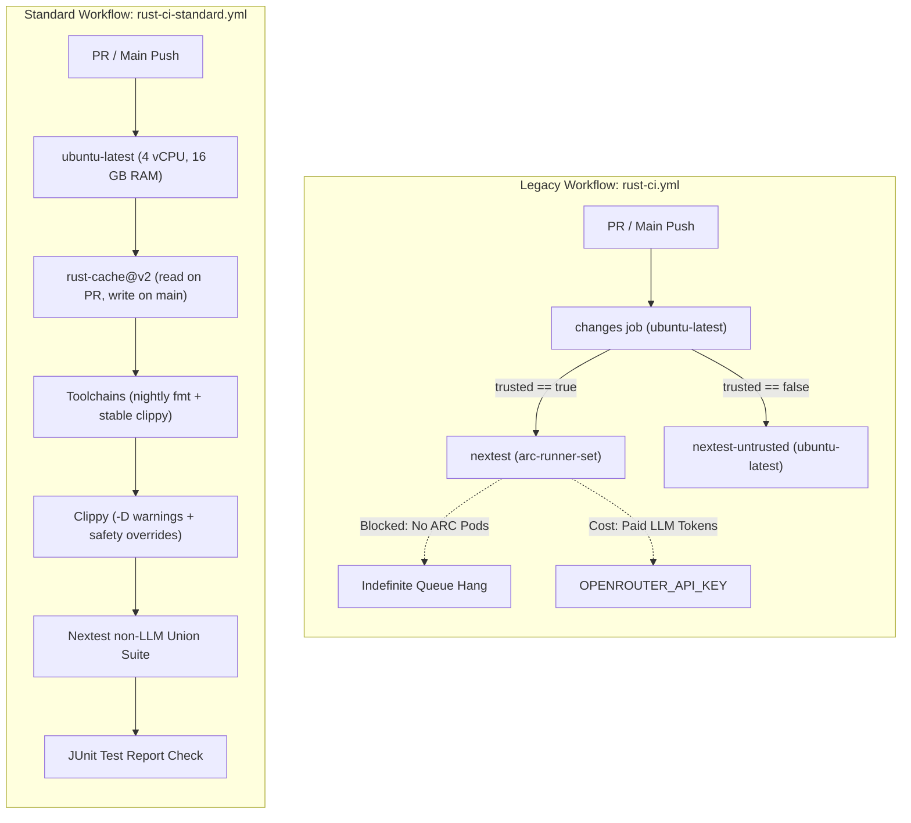
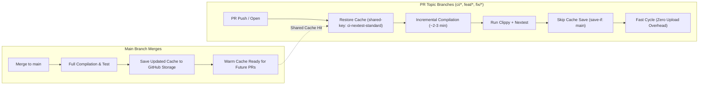

# Runners & Zero-Cost Alternatives (`KarakaraLabs/karakara-os`)

When Karakara OS was forked from `Agentium OS`, several workflows referenced custom self-hosted runner labels (`arc-runner-set`, and `kvm-enabled` for a since-removed v1 sandbox workflow) and paid LLM API calls (`OPENROUTER_API_KEY`). Because `KarakaraLabs/karakara-os` is a **public repository**, standard GitHub-hosted Linux x64 and ARM64 runners are **100% free (`$0`)** and can replace most self-hosted lanes.

---

## 1. Runner Comparison Matrix

| Runner Label | Type | Hardware (Public Repo) | Cost | Workflows Using It |
|---|---|---|---|---|
| `ubuntu-latest` | GitHub-hosted standard | 4 vCPU, 16 GB RAM, 14 GB SSD (x86_64) | **`$0`** | `rust-ci-standard.yml` (standard PR nextest & fmt/clippy), `secret-scan.yml`, `reuse.yml`, `release-please.yml`, `release-pr-postprocess.yml`, `release-publish.yml` |
| `ubuntu-22.04` | GitHub-hosted standard | 4 vCPU, 16 GB RAM (x86_64, glibc 2.35) | **`$0`** | `release-please.yml`, `release-publish.yml` (`x86_64-unknown-linux-gnu` binary builds) |
| `ubuntu-22.04-arm` | GitHub-hosted ARM64 | 4 vCPU, 16 GB RAM (aarch64, glibc 2.35) | **`$0`** | `release-please.yml`, `release-publish.yml` (`aarch64-unknown-linux-gnu` native binary builds) |
| `arc-runner-set` | Self-hosted Kubernetes ARC | Custom K8s pod pool (not provisioned) | **Infra cost** | `rust-ci.yml` (legacy reference lane), `claude-md-sync.yml`, `k8s-pilot-validation.yml` |

---

## 2. Zero-Cost Migration Paths for Self-Hosted Workflows

### A. Dedicated Standard Workflow: `rust-ci-standard.yml` (Issue #69)
- **Resolved in Issue #69:** Rather than modifying the legacy `rust-ci.yml` (which is kept for reference with its ARC and secret configurations), a new dedicated standard workflow `.github/workflows/rust-ci-standard.yml` runs on GitHub-hosted `ubuntu-latest` ($0) with `CI_FEATURES_UNTRUSTED` (`baml-rt-tools/http-tools,baml-rt-builder/http-tools,baml-rt-builder/dev-tools,baml-agent-runner/http-tools,baml-agent-runner/memory`).
- **Triggers:** Automatically runs on pull requests (`pull_request`), pushes to `main` (`push`), and manual `workflow_dispatch`. Pushing to PR branches triggers solely via `pull_request` to avoid duplicate workflow runs.
- **Standalone:** Requires no third-party API keys and no self-hosted runner infrastructure.
- **Observed Execution Durations (`ubuntu-latest` 4 vCPU):**
  - Setup Phase (system packages, LLVM/lld, stable + nightly toolchains, Node 22, TS 6.x): ~40s
  - Linter Phase (`cargo clippy --workspace --all-targets`): ~7m 30s (cold) / ~2-3m (warm cache)
  - Test Phase (`cargo nextest run --workspace` non-LLM): ~1-2m (reuses compilation artifacts from clippy)
  - Report Phase (JUnit XML check publish): ~2s
  - Total Duration: ~9-11 min (cold build) / ~3-5 min (warm build cache)
- **Compilation Performance Profile & Duration Drivers:**
  - **Workspace Scale:** Karakara OS encompasses 48 workspace crates, 920+ Rust source files, and 650+ transitive crate dependencies (including Tokio, Axum, SurrealDB, FastEmbed, ONNX/tract, and QuickJS native C-bindgen).
  - **Hardware Allocation:** Standard GitHub-hosted `ubuntu-latest` runners provide 4 vCPUs and 16 GB RAM, capping Cargo build parallelism to 4 concurrent compilation jobs (`cargo -j 4`).
  - **Full Target Coverage (`--all-targets`):** The workflow lints not only core library targets, but all binaries (`bin`), test harnesses (`tests/*.rs`), and dev examples. In Rust, each integration test file compiles and links as an independent executable binary.
  - **Cold Builds vs. Warm Cache (`rust-cache@v2`):**
    - *Cold builds* (~7m 30s linter / ~9-11 min total) occur on initial branch setup or cache key resets, compiling all 650+ third-party dependencies from scratch.
    - *Warm cache builds* (~2-3 min linter / ~3-5 min total) occur on routine PR checks once dependencies are cached on `main`, compiling only the incremental code differences.
- **Local Verification Alternative:**
  ```bash
  just fmt
  just clippy
  just test-unit
  ```

### B. Side-by-Side Comparison: Legacy `rust-ci.yml` vs. `rust-ci-standard.yml`

| Dimension | Legacy Reference (`rust-ci.yml`) | Standard Workflow (`rust-ci-standard.yml`) |
|---|---|---|
| **Primary Runner Label** | `arc-runner-set` (self-hosted Kubernetes pod pool) | `ubuntu-latest` (GitHub-hosted standard Azure v5 VM) |
| **Compute Cost on Public Repo** | Requires provisioned K8s runner infrastructure | **`$0` (100% free / unlimited minutes)** |
| **Secrets & Third-Party APIs** | Requires `OPENROUTER_API_KEY`, ClickUp, Notion, Slack tokens | **None ($0, standalone non-LLM execution)** |
| **LLM Integration Hops** | Runs `llm-tests` against live external models | Omitted via `CI_FEATURES_UNTRUSTED` (kept local/manual) |
| **Execution Reliability** | Jobs hung indefinitely due to unprovisioned ARC pool | Executes immediately on GitHub standard pool |
| **Linter Configuration** | Strict `-D warnings` on floating stable compiler | `-D warnings` with overrides for compiler version drift |
| **Caching Lifecycle** | Separate `ci-nextest` / `ci-nextest-untrusted` caches | Single `ci-nextest-standard` cache (save only on `main`) |
| **PR Branch Triggers** | Triggered both on `push` and `pull_request` (duplicate runs) | Triggered solely on `pull_request` (`push` scoped to `main`) |
| **Test Reporting** | JUnit check annotation via `mikepenz/action-junit-report` | JUnit check annotation via `mikepenz/action-junit-report` |
| **Repository Status** | Preserved untouched for architectural reference | **Active default PR verification gate** |

### C. Architecture & Caching Diagrams

#### 1. Architectural Workflow Topology: Legacy vs. Standard



#### 2. Caching & Compilation Lifecycle (`Swatinem/rust-cache@v2`)



### D. microVM tool tests (`--features sandbox-e2e-kvm`) — Local Today, `ubuntu-latest` If Added to CI
- **Current state:** No workflow. The tests need `/dev/kvm` and a digest-pinned tool-runtime image; run them locally with `just test-kvm`.
- **`$0` Path if a workflow is added:** Standard GitHub-hosted `ubuntu-latest` runners (Azure v5 VMs) support nested virtualization and expose `/dev/kvm`. A job on `ubuntu-latest` needs one permission step before running the recipe:
  ```yaml
  - name: Enable /dev/kvm permissions on ubuntu-latest
    run: |
      ls -la /dev/kvm
      sudo chmod 666 /dev/kvm
  ```

### E. `claude-md-sync.yml` — Switch Runner to `ubuntu-latest` (Keep On-Demand)
- **Current bottleneck:** Uses `runs-on: arc-runner-set` even though the job only invokes `git`, `jq`, `curl`, `python3`, and `gh`.
- **`$0` Compute Alternative:** Replace `runs-on: arc-runner-set` with `runs-on: ubuntu-latest`. Keep the trigger on `workflow_dispatch` (or manual execution) unless an `OPENROUTER_API_KEY` budget is allocated for automated documentation PRs.

### F. `k8s-pilot-validation.yml` — Run Locally via `just`
- **Current bottleneck:** Spins up a multi-node `k3d` cluster, Argo CD, SurrealDB, and local Docker registry for up to 90 minutes, which can CPU-starve standard 4-vCPU runners.
- **`$0` Alternative:** Keep `k8s-pilot-validation.yml` disabled in CI (`workflow_dispatch` only) and run the authoritative validation locally before cutting a release:
  ```bash
  just verify-k8s-pilot-package
  ```

