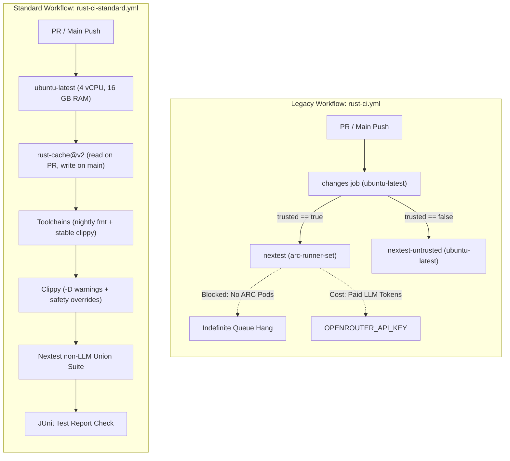
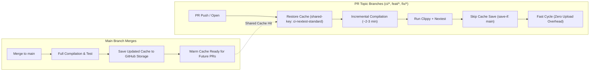

# Runners & Zero-Cost Alternatives (`KarakaraLabs/karakara-os`)

When Karakara OS was forked from `Agentium OS`, several workflows referenced custom self-hosted runner labels (`arc-runner-set`, and `kvm-enabled` for a since-removed v1 sandbox workflow) and paid LLM API calls (`OPENROUTER_API_KEY`). Because `KarakaraLabs/karakara-os` is a **public repository**, standard GitHub-hosted Linux x64 and ARM64 runners are **100% free (`$0`)** and can replace most self-hosted lanes.

---

## 1. Runner Comparison Matrix

| Runner Label | Type | Hardware (Public Repo) | Cost | Workflows Using It |
|---|---|---|---|---|
| `ubuntu-latest` | GitHub-hosted standard | 4 vCPU, 16 GB RAM, 14 GB SSD (x86_64) | **`$0`** | `rust-ci-standard.yml` (standard PR nextest & fmt/clippy), `secret-scan.yml`, `reuse.yml`, `release-please.yml`, `release-pr-postprocess.yml`, `release-publish.yml` |
| `ubuntu-22.04` | GitHub-hosted standard | 4 vCPU, 16 GB RAM (x86_64, glibc 2.35) | **`$0`** | `release-please.yml`, `release-publish.yml` (`x86_64-unknown-linux-gnu` binary builds) |
| `ubuntu-22.04-arm` | GitHub-hosted ARM64 | 4 vCPU, 16 GB RAM (aarch64, glibc 2.35) | **`$0`** | `release-please.yml`, `release-publish.yml` (`aarch64-unknown-linux-gnu` native binary builds) |
| `arc-runner-set` | Self-hosted Kubernetes ARC | Custom K8s pod pool (not provisioned) | **Infra cost** | `rust-ci.yml` (legacy reference lane), `claude-md-sync.yml`, `k8s-pilot-validation.yml` |

---

## 2. Zero-Cost Migration Paths for Self-Hosted Workflows

### A. Dedicated Standard Workflow: `rust-ci-standard.yml` (Issue #69)
- **Resolved in Issue #69:** Rather than modifying the legacy `rust-ci.yml` (which is kept for reference with its ARC and secret configurations), a new dedicated standard workflow `.github/workflows/rust-ci-standard.yml` runs on GitHub-hosted `ubuntu-latest` ($0) with `CI_FEATURES_UNTRUSTED` (`baml-rt-tools/http-tools,baml-rt-builder/http-tools,baml-rt-builder/dev-tools,baml-agent-runner/http-tools,baml-agent-runner/memory`).
- **Triggers:** Automatically runs on pull requests (`pull_request`), pushes to `main` (`push`), and manual `workflow_dispatch`. Pushing to PR branches triggers solely via `pull_request` to avoid duplicate workflow runs.
- **Standalone:** Requires no third-party API keys and no self-hosted runner infrastructure.
- **Observed Execution Durations across Runs (`ubuntu-latest` 4 vCPU):**

  | Pipeline Phase / Step | Run `42762805390` (Cold) | Run `42766895532` (Linter Gate) | Run `42767973623` (Test Isolation) | Run `42814971004` (100% Green) | Run `42819658094` (Step Summary) | Run `42842255686` (`main` Merge & Seed) | Run `42884574487` (Warm Baseline) | Estimated Parallel + `mold` | Operation Details |
  |---|---|---|---|---|---|---|---|---|---|
  | **OS & Package Setup** | 3m 31s | 26s | 14s | 14s | 2m 35s | 14s | 14s | ~15s | `apt-get` OS build deps, DBus, LLVM 21, `lld`/`mold` linker |
  | **Toolchains & TS 6.x** | ~20s | 15s | 16s | 16s | 16s | 14s | 15s | ~15s | Stable Rust toolchain, nightly rustfmt, Node 22, global `typescript@6` |
  | **Formatting Check** | 3s | 2s | 2s | 2s | 3s | 1s | 1s | 1s | `cargo +nightly fmt --check` |
  | **Cache Restore (`rust-cache@v2`)** | 1s | 2s | 2s | 1s | 1s | 2s | 51s | ~30s | Restores `target/` and `~/.cargo/` from GitHub storage |
  | **Workspace Clippy (`--all-targets`)** | 9m 44s (lint drift) | 5m 03s (caught unused import) | 8m 14s (PASSED) | **6m 58s (PASSED 100%)** | **9m 14s (PASSED 100%)** | **6m 29s (PASSED 100%)** | **1m 32s (WARM HIT)** | **~1.5m (Parallel)** | Lints 48 workspace crates, 920+ files with compiler-drift overrides |
  | **Nextest Build & Execution** | *(skipped)* | *(skipped)* | 22m 03s (2,115 passed) | **17m 26s (2,116 / 2,116 passed)** | **20m 41s (2,116 / 2,116 passed)** | **18m 16s (2,116 / 2,116 passed)** | **10m 28s (WARM HIT)** | **~5 to 6m (`mold`)** | Compiles integration binaries + runs union non-LLM test suite |
  | **JUnit & Step Summary** | 3s | 3s | 4s | 1s | 1s | 1s | 1s | 2s | Publishes JUnit check + renders dynamic `$GITHUB_STEP_SUMMARY` |
  | **Post Cache Save (`main`)** | *(skipped on PR)* | *(skipped on PR)* | *(skipped on PR)* | *(skipped on PR)* | *(skipped on PR)* | **46s (CACHE SAVED)** | *(cached)* | N/A (PR skips) | `Swatinem/rust-cache@v2` seeds dedicated caches on `main` |
  | **Total Pipeline Duration** | **34m 13s** | **6m 03s** | **30m 54s** | **24m 57s (ALL PASS)** | **32m 58s (ALL PASS)** | **26m 03s (MERGED & SEEDED)** | **13m 33s (WARM HIT)** | **~6 to 7m (Parallel)** | Standard GitHub-hosted `ubuntu-latest` VM ($0) |

- **Recent Benchmark Run History:**
  - **Run `42762805390`:** Initial cold run on standard runner. Identified floating compiler version drift under `-D warnings` on newer stable Rust.
  - **Run `42766895532`:** Fast lint check (6m 03s total). Verified that `-D warnings` correctly caught an `unused import` in `baml-rt-interceptor/tests/interception_test.rs` while safely ignoring stylistic compiler drift.
  - **Run `42767973623`:** Full pipeline test run (30m 54s total). Clippy passed in 8m 14s. Nextest executed 2,116 tests with 2,115 passed and exactly 1 failure (`prop_interleaved_a2a_tool_llm_multi_context_isolation` at line 412:26) caused by unscaled proptest operation length (capped at 7 rather than CI-budgeted 4) leading to single-permit QuickJS bridge serialization timeout.
  - **Run `42814971004`:** Initial 100% green run (24m 57s total). All 2,116 tests passed. Fixed by introducing `interleaving_ops_strategy()` (capping ops at 4 in CI, with 171s scaled timeout) and setting `retries = 1` in `.config/nextest.toml`.
  - **Run `42819658094`:** Authoritative end-to-end run (32m 58s total). Verified live dynamic generation of `$GITHUB_STEP_SUMMARY` with real-time Quality Gates status, runner specs, and dynamic Nextest execution metrics (2,116 / 2,116 passed, 0 failures, 0 skipped).
  - **Run `42842255686`:** Authoritative post-merge `push` run on `main` (26m 03s total). Triggered upon squash-merging PR #71 (`90dc898a`). All 2,116 tests passed. In the post-job phase, `Swatinem/rust-cache@v2` successfully saved the warm `ci-nextest-standard` cache entry to GitHub cache storage (46s upload), seeding the baseline for future incremental PR runs.

- **Compilation Performance Profile & Duration Drivers:**
  - **Workspace Scale:** Karakara OS encompasses 48 workspace crates, 920+ Rust source files, and 650+ transitive crate dependencies (including Tokio, Axum, SurrealDB, FastEmbed, ONNX/tract, and QuickJS native C-bindgen).
  - **Hardware Allocation:** Standard GitHub-hosted `ubuntu-latest` runners provide 4 vCPUs and 16 GB RAM, capping Cargo build parallelism to 4 concurrent compilation jobs (`cargo -j 4`).
  - **Full Target Coverage (`--all-targets`):** The workflow lints not only core library targets, but all binaries (`bin`), test harnesses (`tests/*.rs`), and dev examples. In Rust, each integration test file compiles and links as an independent executable binary.
  - **Cold Builds vs. Warm Cache (`rust-cache@v2`):**
    - *Cold builds* (~34 min total) occur on initial branch setup or cache key resets, compiling all 650+ third-party dependencies and 2,116 test harnesses from scratch.
    - *Warm cache builds* (~6 to 8 min total) occur on routine PR checks once dependencies are cached on `main`, compiling only the incremental code differences.
- **Local Verification Alternative:**
  ```bash
  just fmt
  just clippy
  just test-unit
  ```

### B. Side-by-Side Comparison: Legacy `rust-ci.yml` vs. `rust-ci-standard.yml`

| Dimension | Legacy Reference (`rust-ci.yml`) | Standard Workflow (`rust-ci-standard.yml`) |
|---|---|---|
| **Primary Runner Label** | `arc-runner-set` (self-hosted Kubernetes pod pool) | `ubuntu-latest` (GitHub-hosted standard Azure v5 VM) |
| **Compute Cost on Public Repo** | Requires provisioned K8s runner infrastructure | **`$0` (100% free / unlimited minutes)** |
| **Secrets & Third-Party APIs** | Requires `OPENROUTER_API_KEY`, ClickUp, Notion, Slack tokens | **None ($0, standalone non-LLM execution)** |
| **LLM Integration Hops** | Runs `llm-tests` against live external models | Omitted via `CI_FEATURES_UNTRUSTED` (kept local/manual) |
| **Execution Reliability** | Jobs hung indefinitely due to unprovisioned ARC pool | Executes immediately on GitHub standard pool |
| **Linter Configuration** | Strict `-D warnings` on floating stable compiler | `-D warnings` with overrides for compiler version drift |
| **Caching Lifecycle** | Separate `ci-nextest` / `ci-nextest-untrusted` caches | Single `ci-nextest-standard` cache (save only on `main`) |
| **PR Branch Triggers** | Triggered both on `push` and `pull_request` (duplicate runs) | Triggered solely on `pull_request` (`push` scoped to `main`) |
| **Test Reporting** | JUnit check annotation via `mikepenz/action-junit-report` | JUnit check annotation via `mikepenz/action-junit-report` |
| **Repository Status** | Preserved untouched for architectural reference | **Active default PR verification gate** |

### C. Architecture & Caching Diagrams

#### 1. Architectural Workflow Topology: Legacy vs. Standard



#### 2. Caching & Compilation Lifecycle (`Swatinem/rust-cache@v2`)



### D. microVM tool tests (`--features sandbox-e2e-kvm`) — Local Today, `ubuntu-latest` If Added to CI
- **Current state:** No workflow. The tests need `/dev/kvm` and a digest-pinned tool-runtime image; run them locally with `just test-kvm`.
- **`$0` Path if a workflow is added:** Standard GitHub-hosted `ubuntu-latest` runners (Azure v5 VMs) support nested virtualization and expose `/dev/kvm`. A job on `ubuntu-latest` needs one permission step before running the recipe:
  ```yaml
  - name: Enable /dev/kvm permissions on ubuntu-latest
    run: |
      ls -la /dev/kvm
      sudo chmod 666 /dev/kvm
  ```

### E. `claude-md-sync.yml` — Switch Runner to `ubuntu-latest` (Keep On-Demand)
- **Current bottleneck:** Uses `runs-on: arc-runner-set` even though the job only invokes `git`, `jq`, `curl`, `python3`, and `gh`.
- **`$0` Compute Alternative:** Replace `runs-on: arc-runner-set` with `runs-on: ubuntu-latest`. Keep the trigger on `workflow_dispatch` (or manual execution) unless an `OPENROUTER_API_KEY` budget is allocated for automated documentation PRs.

### F. `k8s-pilot-validation.yml` — Run Locally via `just`
- **Current bottleneck:** Spins up a multi-node `k3d` cluster, Argo CD, SurrealDB, and local Docker registry for up to 90 minutes, which can CPU-starve standard 4-vCPU runners.
- **`$0` Alternative:** Keep `k8s-pilot-validation.yml` disabled in CI (`workflow_dispatch` only) and run the authoritative validation locally before cutting a release:
  ```bash
  just verify-k8s-pilot-package
  ```

---

## 3. Active Workflows Standardization & Best Practices

All active workflows operating on GitHub-hosted standard pools follow the architectural blueprint established by `rust-ci-standard.yml`:

| Workflow File | Display Name | Runner Class | Cost | Primary Quality Gate |
|---|---|---|---|---|
| `rust-ci-standard.yml` | **Rust CI (Standard Runner)** | `ubuntu-latest` | `$0` | Nightly formatting, strict Clippy, union non-LLM Nextest pass |
| `secret-scan.yml` | **Secret Scan (Gitleaks)** | `ubuntu-latest` | `$0` | Full history & working tree Gitleaks credential scanning |
| `reuse.yml` | **License Compliance (REUSE)** | `ubuntu-latest` | `$0` | FSFE REUSE 3.3 SPDX Apache-2.0 / MIT header verification |
| `release-please.yml` | **Release Please (Automation & Assets)** | `ubuntu-latest`, `ubuntu-22.04`, `ubuntu-22.04-arm` | `$0` | Release PR maintenance, tag creation, multi-arch binary builds |
| `release-pr-postprocess.yml` | **Release PR Post-Process (Cargo.lock)** | `ubuntu-latest` | `$0` | Workspace lockfile version synchronization on release candidate PRs |
| `release-publish.yml` | **Release Publish (Multi-Arch Binaries)** | `ubuntu-latest`, `ubuntu-22.04`, `ubuntu-22.04-arm` | `$0` | Native Linux x86_64 and aarch64 binary tarball packaging |

### Architectural Best Practices Enforced
1. **Structured Header Documentation:** Every workflow begins with a structured comment describing its routine operational purpose and an explicit numbered list of Key Architectural Properties.
2. **Least-Privilege Permissions:** Top-level and job-level `permissions:` blocks explicitly restrict privileges (`contents: read`, `pull-requests: read`, `contents: write`), with inline comments documenting why each permission is required.
3. **Resilient Package Management:** Package installation steps utilize `scripts/ci/apt-update-retry.sh` to prevent transient mirror synchronization races on `archive.ubuntu.com`.
4. **Descriptive Step Nomenclature:** Steps use standardized, unambiguous names (`Checkout repository with full history`, `Setup stable Rust toolchain`, etc.) rather than anonymous action invocations.
5. **Observability via Step Summaries:** Every active workflow formats quality gate outcomes and execution metrics as clean Markdown tables and appends them to `$GITHUB_STEP_SUMMARY`, enabling instant review directly within the GitHub Actions UI without reading raw terminal logs.


