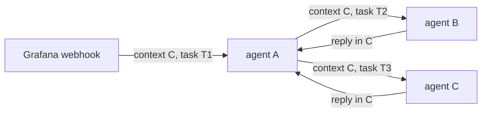

# A2A execution-context continuity

Status: ready for implementation
Baseline: `main` at `0191ed6b`

Scope: preserve one execution context across delegation and let each logical
agent read its own participation history in that context across task boundaries.

This document replaces the historical designs in
[`archive/a2a-child-session-continuity-plan.md`](archive/a2a-child-session-continuity-plan.md)
and
[`archive/a2a-conversation-history-design.md`](archive/a2a-conversation-history-design.md).
It does not treat a context as a conversation, and it does not give every agent
an unfiltered view of the context.

## 0. Current baseline

The stable-identity prerequisites are already on `main`:

- `3379e27c` — derive `AgentId` at boot;
- `f1bf61bb` — cut provenance over to stable agent identities;
- `747b0c9f` — carry boot and artifact attribution on execution records;
- `5e6b8bde` — remove the instance dimension from routing;
- `0191ed6b` — read the newest bounded transcript tail for agent prompts.

Do not re-implement those in this plan. The remaining gaps are:

- delegated A2A still derives a child `a2a:` context from the child task;
- delegated prompt history is still task-filtered;
- there is no agent-scoped `ContextHistoryView` or retrieval tool;
- there is no `(context_id, AgentId)` execution lease;
- there is no context revision binding or guarded undeploy;
- cross-runner delivery does not yet verify `AgentId` plus artifact hash
together.

`fix/child_conversation_history` is historical reference, not an implementation
base. Do not merge or rebase it wholesale. See §14.

## 1. Decision

The whole document rests on one invariant:

> Within a context, one `AgentId` represents one logical participant across all
tasks, invocations, signals, turns, restarts, and relocations. Only one active
boot may own that participant at a time.

**One `ContextId` is one execution or correlation window. Delegation does not
change it.**

**An agent prompt reads that `AgentId`'s history in the context across all
tasks.**

Concurrent work inside one context is supported and load-bearing. A single
invocation may open several delegated tool sessions at once, so several child
tasks of one context can be in flight together, including several tasks for one
target `AgentId`. A landed regression test already pins this:
`test_internal_a2a_parallel_same_context_child_tasks_and_provenance` fans out six
child A2A streams under one parent, and the runtime replaced its global
single-thread handover lane with a per-bridge lane so that it can. The design
therefore assumes parallel tasks rather than serialized turns, and states its
ownership and ordering rules accordingly:

- several tasks of one `(context_id, agent_id)` pair may run concurrently on the
  owning boot;
- a second boot must never become a second writer for that pair;
- event order is a durable serialization order for paging and projection, not a
  claim about causality between concurrent branches.

The identities have separate jobs:

| Identity | Meaning |
| --- | --- |
| `ContextId` | One execution or correlation window. It may contain ingress, several tasks, several agents, and nested delegation. |
| `TaskId` | One unit of work in the context. It remains an attribution and operator-query key. |
| `AgentId` | Stable identity of one packaged agent. It remains the same across boots, relocation, and replicas of the same package. |
| `MessageId` | One message. |

`AgentId` is the agent identity used by provenance and prompt-history reads. It
originates from a canonical hash of the packaged agent. Changing or renaming
the package creates a new `AgentId`; the old agent and its history remain in
provenance.

The canonical inputs and the `AgentId` derivation are settled in
[`agent-identity-plan.md`](agent-identity-plan.md): a source identity over the
manifest projection, authored sources, generated prompt artifacts, and the
dispatch table, with the repository version excluded. Runtime process data,
runner identity, deployment timestamps, and routing fields never make an
otherwise identical packaged agent receive a new `AgentId`.

Two identifiers travel together from here on. `AgentId` answers which agent
source, and the artifact hash answers which exact executable package. Neither
implies the other, which is why both appear in bindings, boots, and task
attribution.

The internal routing address is the package name alone. `AgentInstanceId` is
removed, so there is no instance component left to carry provenance or history
meaning.

## 2. Required behavior

### 2.1 Delegation keeps the execution context

`system/internal_a2a` sends the caller's `contextId` unchanged and creates a
fresh child task for each delegated tool session.

```text
context C

agent A, parent task T1
  delegates to agent B

agent B, child task T2
  contextId = C
  taskId    = T2
  parent    = T1
```

A later delegation to B in the same context gets a new task but reads B's prior
participation:

```text
first delegation:  context C, child task T2, AgentId B
second delegation: context C, child task T3, AgentId B

B's second prompt may read B's rows from T2 and T3.
```

No new `a2a:` context is created. There is no slot, child-context parser, or
history rule based on a reserved prefix.

### 2.2 Agent views are agent-scoped, not task-scoped

A context carries a typed event stream, not a chat transcript. History rows are
events such as an ingress signal, a prompt invocation, a model result, a tool
operation, or an emitted signal. Chat messages are one event kind among others.

The prompt-facing read contract is:

```text
ContextHistoryView(context_id, agent_id, window)
```

It does not take a task filter. A task-scoped read may use:

```text
ContextHistoryView(context_id, agent_id, window, task_id)
```

For agent P in context C, include events where P is actor or target:

- signals and messages received by P;
- signals and messages emitted by P;
- prompt invocations and model results for P;
- tool and session operations executed by P;
- planning rows owned by P, when the prompt profile includes planning;
- compaction summaries valid for the same agent view, once agent-aware
  compaction exists;
- all matching rows across tasks in C.

Exclude:

- events exchanged only between other agents;
- other agents' tool, session, and planning internals;
- unrelated task activity in which P did not participate.

Task-filtered reads remain available for task replay, task inspection, status,
artifacts, and operator queries.

Section 4.4 defines what "full history" means, since a bounded automatic window
is not the same promise as complete retrieval.

### 2.3 The full context graph remains available

The model prompt and the operator graph are different views of the same stored
provenance.

```text
ContextTimeline(context_id)
  every event in the context, ordered, unfiltered by agent

AgentParticipationView(context_id, agent_id)
  the complete durable record of events where one agent is actor or target,
  across all tasks; this is the source of truth for "full history"

ContextHistoryView(context_id, agent_id, window)
  the prompt-facing projection over AgentParticipationView, bounded by the
  automatic window and pageable through the retrieval tool

TaskView(context_id, task_id)
  the complete task for replay and operator inspection
```

Mermaid and operator graph export use `ContextTimeline`. They must support
non-conversational roots such as webhooks and polling windows. They must not
assume that every context begins with a human message or alternates between two
chat roles.

### 2.4 Events carry typed attribution

A chat-shaped sender and recipient pair alone does not describe an execution
context. A tool operation, a model result, or an emitted signal has no natural
chat role.

Every projected event carries:

```text
event_kind         ingress_signal | prompt_invocation | model_result |
                   tool_operation | emitted_signal | delegation | task_state |
                   audit_decision
context_id
task_id            when the event belongs to one task
actor_agent_id     when an agent performed or emitted the event
actor_name         package name snapshot for operator display
target_agent_id    when the event is addressed to an agent
target_name        package name snapshot for operator display
source_identity    for ingress, the external source
```

Actor and target are optional per kind. An ingress signal has an actor of
`Ingress(source identity)` and a target agent. A prompt invocation has an actor
agent and no target. A delegation has both.

Chat roles are a rendering concern, not a storage model. `MessageReceived` and
`MessageSent` remain A2A transport events with their existing direction-
dependent `agent_id` field, which is why the projection must not treat that
field as an author field.

`audit_decision` is the operator-only kind defined in section 4.6. It records a
semantic decision about routing or ownership, never mutable current state, and it
is excluded from agent views.

Provenance stores one `Agent` node per stable `AgentId`, carrying the identity
digest and the package name. Artifact metadata does not belong on that node:
repository versions can share one `AgentId`, so the artifact hash, deployment
content hash, and repository version live on a separate `AgentArtifact` node.
Prompt ownership compares `AgentId` values only.

Execution records carry the boot and artifact that produced them, because a
boot referencing an artifact does not prove which boot ran a given task:

```text
TaskExecution -wasExecutedBy->    Agent          (PROV activity to agent)
TaskExecution -used->             AgentArtifact  (PROV activity to entity)
TaskExecution -executedUnderBoot-> BootActivity   (custom activity to activity)
```

`wasAssociatedWith` is deliberately not used for the boot edge. In PROV it links
an activity to an agent, so pointing it at another activity would make the graph
invalid and would break any generic PROV consumer or query generator that trusts
the relation's domain and range.

`executedUnderBoot` is a typed relation with one meaning:

```text
executedUnderBoot
  domain:    TaskExecution
  range:     exactly one BootActivity
  semantics: the boot activity whose process lifetime executed this task
  purpose:   group executions by process lifetime; audit which revision and
             process ran a task
  not:       an identity relation, and not a substitute for history ownership
```

A task execution event carries `boot_event_id` and `artifact_hash` so the
normalizer creates all three edges from the event itself. It must never consult
the operational lease, which is excluded from provenance and expires.

History filtering still uses only `AgentId`. The boot and artifact edges exist
for audit: which process, running which bytes, executed this task. The ownership
lease is deliberately excluded from provenance, so it cannot answer that.

### 2.5 Delegation lineage is typed provenance

The trusted runtime records delegation before local dispatch or remote
forwarding. The record contains enough information to connect the execution
and deduplicate its prompt representation:

```text
DelegationLinked {
  delegation_id,
  context_id,
  parent_task_id,
  child_task_id,
  caller_agent_id,
  target_agent_id,
  caller_name,
  target_name,
  tool_session_id,
}
```

The exact graph vocabulary may reuse an existing delegation activity, but it
must support these queries:

- child task to parent task;
- child task to caller and target `AgentId` values;
- delegated request and reply to the matching tool session;
- actor and target for relayed events.

The runner records this relation from host-known values. It must not reconstruct
caller identity from `message.metadata.kind` or another caller-controlled
field. The existing A2A `referenceTaskIds` remains on the wire for protocol
compatibility.

A failed delegation-lineage write fails the delegation before dispatch. Without
the relation, the target could process work that later projections cannot
attribute correctly.

### 2.6 Rendering is relative to the reading agent

Rendering depends on the event kind. Chat roles exist only for conversational
invocations, where the projection can map an inbound user or ingress signal to a
`user` turn and the agent's own reply to an `assistant` turn. A signal-driven
invocation renders as labeled signals instead.

For reader P:

| Stored event | Rendering |
| --- | --- |
| Signal or message emitted by P | `assistant` turn in a conversational invocation, otherwise `output signal` |
| Human or ingress event addressed to P | `user` turn, with source attribution when available |
| Event from another agent addressed to P | `user` turn, prefixed with the actor name |
| Event between other agents | omitted |
| Prompt invocation or model result of P | kept according to the existing projection profile |
| Tool operation executed by P | kept according to the existing projection profile |
| Row executed by another agent | omitted |
| Operator-only row | omitted from the agent prompt |

The projection decides the render mode per invocation, so one agent can handle a
chat input and a webhook signal in the same context without either shape being
forced onto the other.

A restarted, relocated, or replicated copy of the same packaged agent uses the
same `AgentId`, so its prior rows remain its own rows. A changed or renamed
package receives a different `AgentId` and does not inherit the prior prompt
history.

### 2.7 Successful delegation appears once in an agent prompt

One successful internal delegation can produce four durable records:

1. caller's `system/internal_a2a` tool call;
2. target's received relay message;
3. target's sent reply message;
4. caller's `system/internal_a2a` tool result.

All four remain in provenance and operator views.

For agent prompts, the relayed messages are canonical. Elide a delegation tool
payload only when `DelegationLinked` proves that a matching relayed message or
reply was persisted.

- The target sees the caller's relayed request once.
- The caller sees the target's relayed reply once.
- An unrelated sibling sees neither exchange.
- If dispatch fails before a matching relay message exists, keep the caller's
  tool error. Failure information must not disappear during deduplication.

Do not deduplicate by text, target name, timestamp proximity, or parent task
alone. A parent task may open several delegations.

### 2.8 Cross-runner behavior remains supported

Cross-runner routing already exists and must not regress.

The caller-side router obtains the caller `AgentId` from the running caller,
not from request metadata. For a local target, the selected `A2aAgent` exposes
its actual `AgentId` and artifact hash before dispatch.

For a remote target, cluster placement already stores the target package's
content hash and must also store the artifact hash. Placement resolution returns
both the target `AgentId` and the target artifact hash, rather than dropping
them after endpoint selection. The caller records `DelegationLinked` with that
pair and forwards both expected identifiers in a host-controlled envelope or
header.

The remote runner compares both against the selected agent before execution:

```text
expected_agent_id
expected_artifact_hash
```

Verifying only `AgentId` is insufficient. Two artifacts can share one source
identity, so an ID-only check would accept a runner carrying different bytes. A
mismatch means the deployment changed between lookup and delivery; the runner
rejects the request without executing it, and the caller may resolve and retry.

The provenance registries are split. The agent registry maps `AgentId` to package
name and identity digest. The artifact registry maps artifact hash to
repository version and deployment content hash. Neither one alone answers
"which version ran", so task attribution carries both identifiers. The routing
hot path uses the local deployment map or cluster placement table; it does not
query provenance to choose a target. The route key is not used for history
ownership.

This release does not add a trusted-origin flag to prompt-history selection.
History selection depends on context and `AgentId`, not transport origin.

Cluster deployment requires a shared provenance store for cross-runner history.
Without one, routing may still deliver work, but agent history cannot be
continuous across runners. That deployment is unsupported for this contract.

Cross-runner delivery for a pair that already has an owner follows section 4.3.
The caller-side router prefers the recorded owner, and the receiving runner
refuses a turn for a pair it does not own. A stale owner is replaced by lease
expiry, never by two boots sharing the pair.

Distributed causal ordering is not redesigned here. The implementation keeps
current ordering behavior and adds a cross-runner continuity regression test.
Ordering hardening belongs in a separate plan.

The ordering key is a durable serialization order. It makes paging, projection,
and the truncation marker agree with each other, and it gives operator timelines
a stable row order. It does not claim that two concurrent branches happened in
causal sequence, and no contract in this plan depends on such a claim.

## 3. Non-conversational ingress

A webhook or polling event may open context C and dispatch task T1 to agent A.
Agent A may delegate parts of the event to B and C. Every task remains in C, so
the full graph describes one processing window.



- Mermaid reads the full context and renders the pipeline.
- A's prompt reads A's participation in C.
- B's prompt reads B's participation in C across B's tasks.
- C does not receive B's internal history merely because both share C.

This plan provides continuity only inside one context window.

If two webhook deliveries that require shared memory use different context IDs,
this plan cannot connect them. That requires an explicit continuity key such as
an alert fingerprint, source lineage, or workflow thread. The runtime must not
query an agent's unrestricted global history as a fallback. Cross-context
memory is a separate design.

## 4. Storage and provenance contracts

### 4.1 Required invariants

- Every delegated task uses the caller's context ID.
- Every delegated tool session gets a fresh child task ID.
- Every child task has one durable delegation relation to its parent task,
  caller `AgentId`, target `AgentId`, caller and target name snapshots, and tool
  session.
- One packaged agent has the same `AgentId` across boots, relocation, and
  replicas. A changed or renamed package has a different `AgentId`.
- Within one context, one `AgentId` denotes one logical participant. Different
  tasks for that agent remain separate units of work.
- For any `(ContextId, AgentId)` pair, at most one boot holds execution
  ownership at a time. The rules are in section 4.3.
- A context binds a route to one `AgentId` on first participation. Later turns
  resolve through that binding, not through the current deployment. The rules
  are in section 4.5.
- Agent prompts filter by `AgentId` and never infer history scope from the
  presence of `taskId`.
- Operator context reads remain complete and unfiltered by agent.
- Task reads remain task-filtered.
- Successful delegation payloads appear once in agent prompts and remain fully
  visible in operator views.
- Transcript-critical write failures fail the turn or delegation. They are not
  logged and ignored.

### 4.2 Concurrency coverage gate

Parallel same-context fanout already works. It is pinned by the landed
`test_internal_a2a_parallel_same_context_child_tasks_and_provenance`, which opens
six child A2A sessions at once under one parent task and asserts six distinct
child task IDs; the runtime replaced its global single-thread handover lane with
a per-bridge lane specifically to allow it. A plan that serialized child
execution would regress working behavior.

What that test does not prove is row completeness. It asserts child task
uniqueness and each branch's inbound user message, not the whole
transcript-critical set. Sharing a context also increases write pressure on
context-level indexes, which is where contention would show up.

This is not hypothetical. Running the existing fanout scenario with typed
delegation lineage active already logs lost rows:

```text
WARN baml_rt_provenance::store: Failed to record provenance event
  error = Contention { details: "Query not executed: Transaction conflict:
            Write conflict, retry the transaction. This transaction can be retried" }
  context = "effect subscriber"
  event.variant = "tool_completed"
  context_id = "ctx-88-1"
```

The write is dropped and only logged; the scenario still passes because no
assertion looks at each branch's tool-completion rows. So the gate has a
reproducible trigger, and the missing coverage is what hides it.

Before enabling shared-context delegation, the existing fanout scenario must be
extended to cover all transcript-critical rows for every branch:

- inbound messages;
- outbound messages;
- delegation links;
- tool started and completed records;
- final task state.

Fix only the shared writes the extended test exposes. Keep an event-owned node
and its unique transcript-index row in the same transaction. The stable
`Agent` node is immutable registration data; transcript events must not mutate
it on every write. Do not move picker, planning, transcript, and compaction
indexes together under one generic consistency rule.

This is a coverage gate, not a diagnosis of a known defect. The observed
contention above is a symptom to pin down, not a root cause to guess at: extend
the assertions first, then fix only what the extended test breaks. If it passes
unchanged, that is the result to record.

Landed: the extended fanout test asserts inbound and outbound messages, one
`Delegation` row per branch (parent task, tool session, child task), a started
and a completed `ToolCall` row per branch, and the branch's terminal `TaskState`.
It reproduces the contention without touching the driver: six concurrent ToolCall
pairs in one context lose start and completion rows, and sixteen exhaust the
retry budget. The conflicting writes are the reference records every event
re-upserts: the `Context` node, the `Task` entity, the `TaskExecution` activity,
message placeholders, the runner identity, the `TaskExecution` to `Agent`
associations, and the `WAS_LAST_EXECUTED_BY` head pointer.

`build_event_write_plans` now emits up to two plans. Records carrying the event's
`a2a_activity_anchor` are event-owned: their ids are unique to the event, and
they keep the plain per-event transaction together with their transcript-index
row and payloads. Reference records (no anchor) commit in their own plan under a
striped per-context lane, so one branch at a time writes them. A reference write
whose exact content this store already committed is skipped, which keeps lane
work proportional to what changed rather than to event count. Picker, planning,
compaction, and transcript index updates are unchanged.

A separate write-path plan may redesign mutable projections later.

### 4.3 Execution ownership for a context-agent pair

Stable `AgentId` means replicas are indistinguishable in provenance. Without an
ownership rule, two boots can interleave turns for the same
`(ContextId, AgentId)`, and `ContextHistoryView` becomes a two-writer projection
with no coherent event stream.

The rule is scoped to the pair, not the context, so different agents in one
context may still run on different runners. It is scoped to the pair rather than
the task because concurrent tasks of one pair from the owning boot are legal
(section 1): a per-task fence would break supported fanout, and a context-wide
lock would serialize agents that have to stay independent.

```text
- At most one boot holds execution ownership for a (ContextId, AgentId) pair
  at a time.
- Ownership is acquired before the first turn of that pair in the context and
  released when no execution session for that pair remains open.
- A boot that does not hold ownership must not execute the turn. It forwards to
  the owner when the owner is reachable, or returns a typed retryable conflict.
- Replicas of one packaged agent may serve different contexts concurrently.
- The holder must be running the artifact pinned by the route binding. Lease
  acquisition and takeover reject a boot running another artifact.
- Ownership transfers on crash or relocation by lease expiry, and on deploy by
  explicit handoff. A transfer never changes AgentId.
- Parallel tasks from the owning boot remain allowed. The fence is per pair, not
  per task.
```

Operational record:

```text
(context_id, agent_id) -> boot_event_id, runner_id, endpoint, fencing_token, heartbeat_ms
```

This record is operational state, not a public identity and not a provenance
graph node. The row itself, including `heartbeat_ms` and the current token, must
not appear in graph export, context history reads, or any agent prompt.

Semantic decisions taken while maintaining the lease are a different matter and
are recorded in provenance under section 4.6: ownership acquisition, handoff,
takeover, and a refusal to serve a pair.

`boot_event_id` is the lease identity, which is why event-owned boot activities
are a prerequisite. A boot cannot restart, so the pair plus the boot event
identifies one holder lifetime without another ID type.

`fencing_token` is a per-pair counter that increments on every takeover. Every
write scoped to the pair carries the token, and the writer rejects a write whose
token is older than the current lease. Without this, a paused holder can resume
after expiry and write into a transcript another boot now owns.

Placement constraint: the token check must happen inside the same transaction as
the event write, so the lease table has to live in the database that holds the
event writes. The cluster tables are in a different namespace, so a cluster-side
lease row cannot be fenced atomically against provenance writes. Put the lease
table in the provenance database and expose a narrow read for routing.

Operational behavior:

- the caller-side router prefers the recorded owner when it resolves placement,
  so the forwarding path stays one hop;
- the receiving runner still checks ownership, because the router view can be
  stale;
- a finished boot releases its leases for the pairs it no longer serves;
- a crashed boot leaves its leases to expire by heartbeat staleness;
- a planned deploy hands ownership over before the old boot stops accepting
  work. Otherwise a rolling upgrade looks like a conflict outage.

This makes `(context_id, agent_id)` a single-writer projection for the duration
of a session, which is the precondition for agent-aware compaction later. It
does not make the whole context single-writer, so the concurrency gate in 4.2
still applies to context-level indexes.

### 4.4 History completeness contract

The plan must not say "full history" and then deliver a silent item cap. Three
contracts were considered:

```text
1. every prior agent-visible event is inserted into every invocation
2. a lossless compacted representation of older events plus recent raw events
3. everything is durable and retrievable, while only a bounded window is
   inserted automatically
```

Contract 1 does not survive a long-running signal-driven context. Contract 2
requires agent-aware compaction, which is separate work and cannot be a
prerequisite here. This plan adopts contract 3 now and leaves 2 as an addition
on top of it.

Definitions:

```text
full history   every event in the context where the agent is actor or target,
               across all tasks, durable, retrievable in order without loss
visible        actor or target is that AgentId; never a bystander event
window         the newest N events by the durable ordering key, inserted into
               every invocation automatically
```

The automatic window is a delivery choice, not a visibility rule. Events outside
the window stay in `AgentParticipationView` and stay reachable.

Requirements:

- The window is ordered by one durable serialization order within
  `(context_id, agent_id)`, not by insertion timestamp alone, so paging and
  prompt order agree. The key is a stable tie-break for paging and projection; it
  is not a claim of causality between concurrent branches.
- Pagination uses an opaque cursor derived from that ordering key. Offsets are
  not acceptable, because concurrent appends shift them.
- The prompt carries an explicit truncation marker when older events exist, so
  the model knows it can ask for more instead of assuming the window is complete.
- A read-only retrieval tool pages `ContextHistoryView` oldest-ward, applying the
  same visibility and deduplication rules as the prompt projection. The model must
  never see a different set than the prompt would have shown at the same window.
- The tool returns attribution for every row (`event_kind`, actor, target, task,
  timestamp), so a paged event is as interpretable as a streamed one.
- An empty or exhausted page is a terminal state, not an error.
- Rows older than the window are never deleted, and neither compaction nor
  retention may drop them without an explicit operator retention policy.

Agent-aware compaction, when it lands, replaces older raw events in the window
with a summary row and does not remove the raw events. A valid key is at least:

```text
(context_id, agent_id, projection_version)
```

A single context-wide summary cannot replace agent-relative views because one
agent's visible operations differ from another's.

The newest-page correction landed in `0191ed6b`. The remaining contract work is
the retrieval tool, its stable cursor, and agent-scoped visibility.

### 4.5 Revision pinning per context

Stable identity alone does not keep a context continuous across a deploy:

```text
first turn:   route "notion-agent" -> AgentId A, artifact H1
09:05 deploy: new source       -> AgentId B, artifact H2
second turn:  route "notion-agent" -> AgentId B, artifact H2
```

B does not see A's history. That is correct for a new context, and wrong for an
in-flight one: it partitions every active webhook or polling context silently,
with no event and no diagnostic.

A context therefore pins the revision it talks to. This is revision pinning, not
an identity change. `AgentId` stays content-derived and immutable. The context
chooses which revision it addresses.

The binding pins both identities, because one does not determine the other:

```text
ContextRouteBinding
  context_id
  package_name
  agent_id
  artifact_hash        (SHA-256 of the stored artifact bytes)
```

`AgentId` answers which agent source. `artifact_hash` answers which exact
executable package. Versions N and N+1 can share one `AgentId` with different
artifacts, so a binding on `agent_id` alone would accept a boot running other
bytes.

Key rules:

```text
- The binding key is (context_id, package_name). Structured fields, never a
  concatenated string, so no delimiter or stray instance value can silently
  produce another key.
- package_name is a durable deployment-slot name. Renaming it is a new agent
  and therefore a new binding, which is the intended semantics, not an
  accident.
- agent_instance_id does not exist. It is removed from the route type, the HTTP
  path, discovery entries, and placement keys, because it is always "default"
  and its name reads like a replica index. A request that still carries the
  field is rejected at parse time with a typed unsupported error for every
  value, including "default", so no caller can manufacture a second binding by
  varying a string and no old client silently lands on an existing binding. If multiple slots
  ever exist, add an opaque host-assigned slot identifier with a binding
  migration; do not reintroduce a string instance dimension.
```

Composition with ownership is sequential, not competing:

```text
package_name -> binding -> AgentId + artifact_hash -> eligible boot -> lease
```

The binding decides which agent and artifact. The lease decides which boot.

Invariants:

```text
- Once a context has a binding for a package name, that name resolves through
  the binding, never through the current deployment.
- The host creates the binding on first participation, after validating the
  nominated package name against host-owned deployment state.
- Binding creation requires the request to pass the same authentication and
  access checks as dispatch. An unauthenticated or unauthorized request cannot
  create or advance a binding, so presenting a context ID and a package name is
  never enough to pin a context.
- Creation is compare-and-set: insert if absent, then re-read. A turn whose
  resolved (agent_id, artifact_hash) differs from the stored binding does not
  execute.
- A conflicting turn returns a typed error naming both pinned identifiers. It
  never executes against a different revision.
- Deploying a new revision does not change existing bindings.
- Only an explicit rebind or context fork changes a binding.
```

Trust contract, stated precisely:

```text
Request data may nominate a package name, through `params.metadata.target` or a
model-selected delegation target. The host validates that name against
deployment state and resolves it to `AgentId` and artifact hash. Request data
may not supply or override those resolved identifiers, and it may not introduce
a name that is not a deployed package.
```

The earlier phrasing "request metadata cannot create or change the binding" was
too strong and therefore wrong: the first authorized request does trigger
creation. What it cannot do is choose the resolved identity.

The compare-and-set is not theoretical. Two turns can arrive concurrently, both
resolving the route for the first time, across a deploy. Without it both insert,
both execute, and one context ends up with two revisions for one route, which is
the exact failure the binding exists to prevent.

Admission check, not read-time check: the binding is resolved before dispatch. If
it were resolved during projection, the new agent would already have been
invoked and would already have written its own turns into the context.

Availability: a binding is worthless if the pinned revision is no longer
deployed. `deploy_by_hash` currently drains and undeploys the prior revision
before booting the new one, so after a deploy every context pinned to the old
agent and artifact pair has nowhere to run.

Required behavior, in order of preference:

```text
1. keep the pinned revision deployed until its contexts drain;
2. boot the pinned revision on demand from the repository, which is possible
   because artifacts are content-addressed;
3. refuse the turn with a typed "pinned revision unavailable" error.
```

Silent substitution with the new revision is never acceptable.

The lease corroborates the binding. It stays keyed by `(context_id, agent_id)`,
but acquisition and takeover must reject a boot whose running artifact is not the
bound artifact. Otherwise a boot running the new revision could take ownership of
an old pinned pair and serve it with the wrong bytes.

That makes `undeploy` context-aware. It reports the contexts pinned to the
revision with activity inside the retention window and requires an explicit
override, which is recorded. A hard refusal is impractical because contexts do
not formally close, a warning that can be ignored is not a guard, so the
override is the mechanism.

Escape hatches, both explicit and auditable:

```text
rebind(context_id, package_name, new_agent_id, new_artifact_hash, rationale)
    the operator asserts compatibility. Records a revision-boundary event in
    the context. Subsequent turns use the new pair. The assertion is recorded,
    so the history stays honest about the interruption.

close_and_fork(context_id, package_name)
    the context stops and a new context starts under the new revision. No
    shared history, no ambiguity.
```

Do not let a manifest or a deploy declare automatic adoption of contexts bound
to another hash. It sounds convenient, but it turns an explicit operator
decision into an unverifiable build-time claim, and a wrong claim silently mixes
incompatible payload shapes. `rebind` is the same power with an audit trail.

The binding row is operational state, like the lease row, and belongs next to it
rather than in the provenance graph. The row must not appear in graph export,
history reads, or agent prompts.

The decisions that create and change a binding are different and are recorded in
provenance under section 4.6, so an operator can explain why a given context
moved to a given agent and artifact. This section already requires `rebind` to
leave a revision-boundary event; section 4.6 generalizes that rule to the other
binding outcomes.

### 4.6 Operational decisions are recorded as audit events

Operational tables hold mutable current state. Provenance holds immutable
decisions. The two must not be conflated in either direction: a lease row expires
and a heartbeat is noise, so neither belongs in a graph; a binding conflict or an
undeploy override is a permanent fact about why a turn ran the way it did, so
losing it leaves the graph unable to explain itself.

State stays in the operational tables (`context_agent_leases`,
`context_route_bindings`). Decisions are appended as `audit_decision` events with
the attribution defined in section 2.4:

```text
binding_created          context, package, agent_id, artifact_hash
binding_conflict         context, package, pinned pair, resolved pair
revision_rebound         context, package, old pair, new pair, rationale
ownership_acquired       context, agent_id, boot_event_id, runner
ownership_handed_off     context, agent_id, from boot, to boot
ownership_taken_over      context, agent_id, from boot, to boot, reason
pair_served_elsewhere    context, agent_id, owner boot, requesting boot
pinned_revision_missing  context, package, pinned pair, resolved pair
undeploy_override        package, artifact_hash, contexts, operator rationale
```

Rules:

- Audit rows are operator-only. `ContextTimeline` includes them;
  `ContextHistoryView` and every agent prompt exclude them, because the reading
  agent is never the row's explicit actor or target.
- Each row is event-owned and idempotent: a retried request that replays the same
  decision produces one row, not one per attempt.
- A heartbeat, token bump, lease refresh, or TTL touch is never an audit event.
- An audit row is not required for dispatch to be correct; it is required for the
  operator explanation. A failed audit write fails the operation that produced
  it, exactly like a transcript-critical write in section 4.1.
- Audit rows carry no message payload and are never rendered as a chat turn.

## 5. Trust and authorization

Sharing a context does not grant every agent an unfiltered prompt view. The
`AgentId` filter is a visibility policy enforced by the provenance read path.

The host determines `AgentId` from the loaded packaged agent. A routing name
selects a deployed target, but external request metadata cannot claim or
override the executing agent's identity.

Binding creation is an authorization boundary, not a side effect of presenting
two strings. A context binding is durable shared state that decides which agent
a context talks to, so it is created only after the request passes the same
authentication and access checks as dispatch. Otherwise any caller able to name
a context and a deployed package could pin that context before its legitimate
traffic arrives, and the real requests would fail with a conflict against a
binding they never made.

This is not a complete authorization system:

- context ownership is not added here;
- tenant policy is not added here;
- operator access policy is unchanged;
- possession of a context ID must not be described as authentication;
- an authenticated caller that can reach an agent may still create a binding in
  a context it does not own, because cross-context ownership is out of scope.

The contract is narrower: an invoked agent can read its own participation in
the supplied context window.

## 6. Legacy compatibility

Stop producing derived `a2a:` contexts, but retain read compatibility:

- old contexts remain queryable in operator and task views;
- the old prefix may remain as a legacy relay-classification fallback;
- no prompt-history policy may depend on the prefix;
- old child rows are not rewritten into parent contexts;
- old helper APIs may be deprecated after all production writers stop using
  them, rather than removed in the same source-compatible release.

New shared-context rows use typed delegation with caller and target `AgentId`
values. They do not use context-string parsing.

The stable-agent graph cutover has landed (`f1bf61bb`, `747b0c9f`). New writes
use `Agent` with stable `AgentId` values and event-owned boot/artifact edges.
Legacy `AgentRuntimeInstance` vocabulary may remain only for reading old graphs;
new rows must not use the per-boot identity model.

## 7. Changes by layer

### 7.1 Delegation request

`crates/tools/system/src/a2a_session.rs`

- Send `caller_context_id` unchanged as `message.contextId`.
- Keep one fresh `TaskId::for_delegated_child` per tool session.
- Keep `referenceTaskIds` for the parent task.
- Stop calling `ContextId::for_a2a_child`.
- Keep current live-session behavior. `(context, child task)` remains unique.

`crates/baml-rt-core/src/ids.rs`

- Stop using `ContextId::for_a2a_child` for new traffic.
- Retain compatibility helpers until downstream Rust API migration is complete.

### 7.2 Stable `AgentId` (landed contract)

The stable identity, artifact, boot, and provenance graph work is already on
`main`. Keep this section as the contract to preserve; do not re-implement it.

`crates/baml-rt-core/src/ids.rs`

- `AgentId` means one packaged agent, stable across boots and tasks.
- Keep the existing public type. Do not add participant, revision, or runtime
  agent ID types.
- The deterministic constructor and canonical inputs remain defined in
  [`agent-identity-plan.md`](agent-identity-plan.md).

`crates/baml-agent-runner/src/runner.rs` and
`crates/baml-agent-runner/src/agent_package.rs`

- Boot obtains the canonical package hash before building the `A2aAgent`, and
  the verified artifact hash from the deployment record.
- The stable `AgentId` is passed explicitly into the A2A builder; production
  boot does not rely on random generation.
- Package name, identity digest, artifact hash, deployment content hash, and
  repository version remain attached to the identifiers they belong to.

`crates/baml-rt-a2a/src/a2a_transport.rs`

- Production boot paths provide `AgentId`.
- Random IDs remain limited to explicitly ephemeral tests or development
  agents; they do not promise continuity across boots.

`crates/baml-rt-provenance/src/events.rs`

- `AgentBooted` registers the agent's package name, identity digest, and the
  artifact hash it is running.
- Task execution events carry `boot_event_id` and `artifact_hash`, so the
  normalizer builds boot and artifact edges without the lease.

Remaining in this layer:

- Add the typed delegation-lineage event with caller and target IDs and name
  snapshots.

`crates/baml-rt-provenance/src/normalizer.rs`

- New writes use the stable `Agent` node, not `AgentRuntimeInstance`.
- Every boot activity has an event-owned identity such as
  `(agent_id, boot_event_id)` so repeated boots do not collapse.
- Boot and stop activities attach to the stable `Agent` and runner identity. A
  stop references the boot event it closes so repeated boots remain
  distinguishable without another agent ID.

Remaining in this layer:

- Materialize child-task to parent-task and delegation-session relations.
- Preserve retry-idempotent event-owned identities for the new delegation rows.

The identity work is specified in [`agent-identity-plan.md`](agent-identity-plan.md),
including the behavior set, the digest derivation, the `ArtifactHash` contract,
and the atomic publication path. This plan consumes those results and does not
redefine them.

### 7.3 Routing and cross-runner recording

`crates/baml-agent-runner/src/routing.rs`

- Obtain the caller ID from the scoped running agent.
- Resolve a local target package name through host-owned deployment state.
  Request data nominates the name; it never supplies a mapping, `AgentId`, or
  artifact hash.
- Resolve the local target to the selected `A2aAgent` and use that target's
  actual `AgentId` and artifact hash.
- Extend remote placement resolution to retain the target artifact hash and
  derived `AgentId`, rather than dropping them after endpoint selection.
- Resolve the context binding before the current deployment. If the context has
  a binding for the package name, use both its `AgentId` and its artifact hash
  even when the deployment moved.
- Create the binding by compare-and-set on first participation, and refuse the
  turn when either stored identifier differs from the resolved one.
- Parse context, child task, parent reference, and tool-session correlation from
  the host-created request.
- Persist delegation lineage before local dispatch or remote forwarding.
- Acquire the `(context, target AgentId)` lease before dispatch, and release it
  when the pair has no open execution session.
- Prefer the recorded lease owner when resolving remote placement.
- Forward the expected target `AgentId` and artifact hash in host-controlled
  transport data. The receiver rejects a mismatch of either before execution.
- Stamp the fencing token on writes scoped to the pair.
- Record an `audit_decision` row for each ownership and binding decision in
  section 4.6. These rows are operator-critical and never agent-visible.
- Forward the normal A2A body without a child-context gate.
- Do not use caller-controlled metadata as proof of caller or target identity.

If tool-session correlation is not currently available at `route_from`, pass it
through a host-only typed call context. Do not expose it as a prompt-scope flag.
Routing may continue to use `AgentRouteKey` internally, but no provenance or
prompt-history contract depends on it.

### 7.4 Agent-scoped read

`crates/baml-rt-provenance/src/surreal_store/context_reader.rs`

- Add a prompt entry point taking `(context_id, agent_id, window, cursor)`.
- Read across tasks.
- Filter events where the agent is actor or target.
- Filter tool, session, and planning rows to activities executed by that
  `AgentId`.
- Keep task-scoped reads for replay and inspection. A task-specific agent read
  is identified by `(context_id, agent_id, window, task_id)`.
- Return an opaque cursor and a truncation flag with every page.

`crates/baml-rt-provenance/src/read/transcript.rs` and
`crates/baml-rt-provenance/src/surreal_store/transcript_engine.rs`

- Use newest-tail ordering for agent-prompt reads.
- Keep forward ordering for delta and operator pagination.
- Hydrate enough typed identity and delegation lineage for projection.
- Do not infer author from the existing direction-dependent message-agent edge.

### 7.5 Projection

`crates/baml-rt-conversation/src/view.rs`

- Add typed attribution to every event view row: `event_kind`, context, task,
  actor `AgentId` and name, target `AgentId` and name, and source identity.
- Add the stable executing `AgentId` to tool and session rows where needed.
- Preserve the old `a2a:` speaker fallback for legacy relay rows only.

`crates/baml-rt-conversation/src/projection.rs`

- Render per event kind, relative to the reading `AgentId`. Chat roles apply
  only to conversational invocations; signal-driven invocations render labeled
  signals.
- Attribute inbound agent and ingress events.
- Elide other agents' internals.
- Deduplicate successful internal delegation through typed lineage.
- Emit the truncation marker when older events exist.
- Provide a page renderer for the retrieval tool that matches the prompt
  projection for the same window.
- Keep unmatched delegation failures.
- Drop `audit_decision` rows from agent views; they belong to operator timelines
  only.

`crates/baml-rt-a2a/src/conversation_context/projecting_provider.rs`

- Use the current stable `AgentId` directly.
- Request agent history without a task filter.
- Keep task ID available for writes, task-scoped reads, live-session identity,
  and diagnostics.

### 7.6 Operator timeline

`crates/baml-rt-provenance/src/graph_export/sequence.rs`

- Keep `ContextTimeline` export independent from agent-prompt projection.
- Use stable `AgentId` values for agent lifelines and package names for labels.
- Support ingress or host events as roots without inventing a human turn.
- Use typed delegation lineage instead of target-name heuristics when available.
- Include `audit_decision` rows so an operator can explain why a given agent,
  artifact, and boot executed a turn.

## 8. Tests

### 8.1 Identity

- A delegated request carries the caller context unchanged.
- Two delegated sessions in one context have distinct child tasks.
- No new `a2a:` context is produced.
- The child task links to its parent task, caller `AgentId`, target `AgentId`,
  caller and target names, and tool session.

### 8.2 Stable agent

- Two boots of the same packaged agent receive the same `AgentId` and produce
  distinct boot activities.
- Relocation or replication of the same package does not change `AgentId`.
- A changed package receives a different `AgentId`.
- Renaming the package receives a different `AgentId`; the old rows remain
  queryable by operators.
- Two artifacts that share `AgentId` remain distinguishable through
  `AgentArtifact` and through the boot activity that executed each turn.
- Within one context, rows carrying one `AgentId` form one logical participant
  view.

### 8.3 Cross-turn continuity

- Agent B handles task T2 in context C.
- B later handles task T3 in C.
- B's second prompt contains B's relevant events from T2.
- The prompt does not contain unrelated sibling activity.
- An event of each kind is preserved: ingress signal, prompt invocation, model
  result, tool operation, and emitted signal.

### 8.4 Ingress and delegation

- A host webhook creates context C and task T1 for A.
- A delegates to B under C and child task T2.
- Mermaid/operator timeline contains the host event, A, B, both tasks, and the
  delegation relation.
- A's prompt and B's prompt each contain only their agent views.

### 8.5 Projection and deduplication

For one successful A-to-B delegation:

- B sees the request once;
- A sees the reply once;
- the matching internal A2A payload is hidden from each agent prompt;
- operator view keeps the tool call, relay messages, and tool result;
- an unrelated agent sees none of the exchange;
- a failed delegation with no reply keeps its tool error.

### 8.6 Parallel fanout

The fanout path already passes child task uniqueness and inbound-message
assertions. These cases extend that existing scenario rather than introducing
parallelism or expecting it to fail.

- One parent task opens N delegated child tasks in one context.
- Every child task and delegation relation is unique.
- Every transcript-critical row persists: inbound and outbound messages,
  delegation links, tool started and completed records, and final task state, for
  each branch.
- No branch reads sibling tool internals.
- Branches only see sibling events when they are the explicit actor or target.
- The test fails on any logged-and-ignored write error.

### 8.7 History completeness

- The automatic window contains the newest events by the durable ordering key,
  not by insertion timestamp.
- The prompt carries a truncation marker when older events exist, and no marker
  when it does not.
- Paging from the cursor reproduces exactly the events the prompt would have
  shown for the same window, in the same order, with no gaps or duplicates.
- Paging while new events arrive does not shift or repeat rows, because the
  cursor is ordering-key based rather than offset based.
- The final page reports exhaustion as terminal, not as an error.
- The retrieval tool applies the same visibility and deduplication rules, so a
  bystander event never appears.
- Concatenating all pages reconstructs the full `AgentParticipationView` for the
  pair.
- A signal-driven invocation renders labeled signals, not chat turns, and a
  conversational invocation in the same context still renders chat roles.

### 8.8 Cross-runner

- Caller and target run on different runners with a shared provenance store.
- The request keeps the same context and a fresh child task.
- Placement resolution returns the target `AgentId` and the target artifact hash.
- The remote runner verifies both expected identifiers before execution.
- A remote runner carrying the same `AgentId` but a different artifact hash is
  rejected, not executed.
- A deployment change between placement lookup and delivery causes rejection,
  not execution under a different agent identity or a different artifact.
- The target resolves caller attribution from typed lineage.
- A second target task in the same context reads the target agent's first task
  history.
- No trusted-origin or `a2a:` prefix is required.

### 8.9 Execution ownership

- Two boots of the same artifact serve different contexts concurrently without
  conflict.
- A second boot receives a turn for a pair owned elsewhere and does not execute
  it. It forwards or returns a typed conflict.
- Parallel tasks for one pair from the owning boot all succeed.
- A crashed owner's lease expires and a new boot takes over without changing
  `AgentId`, and the pair's history stays readable.
- After takeover, a write carrying the previous fencing token is rejected.
- A planned deploy hands ownership over, and the upgrade does not surface as a
  conflict.
- The lease record never appears in graph export, context history reads, or an
  agent prompt.
- Ownership acquisition, handoff, takeover, and refusal appear as
  `audit_decision` rows in `ContextTimeline` and in no `ContextHistoryView` page.

### 8.10 Legacy relay data and schema cutover

- An old derived context remains readable by operator and task APIs.
- An old relay row without typed delegation lineage keeps legacy relay
  classification.
- New rows never depend on prefix parsing.
- New rows use the landed stable `Agent` graph schema. Legacy
  `AgentRuntimeInstance` rows remain readable; new rows do not write that label.

### 8.11 Revision pinning

- A deploy between two turns of one context keeps the second turn on the pinned
  agent and artifact pair.
- Two artifacts share one `AgentId` but differ in artifact hash. A turn resolving
  to the other artifact is refused even though the `AgentId` matches.
- Two concurrent first turns across a deploy produce exactly one binding, and
  the losing turn does not execute.
- A conflicting turn returns a typed error naming both pinned identifiers.
- Request data may nominate a package name. A request that supplies its own
  mapping, `AgentId`, or artifact hash is ignored or rejected, never bound.
- An unauthenticated or unauthorized request cannot create a binding.
- `undeploy` of a revision with recently active pinned contexts requires an
  explicit override and names those contexts.
- With the pinned revision unavailable, the turn fails with a typed error and
  does not fall through to the new revision.
- A boot running a different artifact cannot acquire or take over the pair lease.
- Task execution events carry `boot_event_id` and `artifact_hash`, and the graph
  contains `executedUnderBoot` and `used` edges from the event alone.
- No provenance edge uses `wasAssociatedWith` between two activities.
- A binding outcome, revision change, or ownership change appears as an
  `audit_decision` row in `ContextTimeline`, and an operator can reconstruct the
  agent, artifact, and boot behind every turn from provenance alone.
- `rebind` records a revision-boundary event, and later turns use the new agent
  and artifact pair.
- `close_and_fork` starts a new context under the new revision with no shared
  history.
- Pinning is per package name, so another agent in the same context can be
  deployed between turns without affecting the pinned one.
- The binding key has no instance dimension. A request carrying
  `agent_instance_id` is rejected at parse time with a typed unsupported error
  for every value, including `"default"`, rather than normalized onto an
  existing binding.
- Binding lookup uses the structured `(context_id, package_name)` fields, so a
  concatenated string that happens to look equal does not match.
- The binding record never appears in graph export, history reads, or prompts.

## 9. Implementation sequence

Landed prerequisites (do not repeat):

1. [landed] canonical package hash and stable `AgentId` derivation;
2. [landed] `ArtifactHash`, blob storage, publish/deploy propagation, and boot
   attribution;
3. [landed] atomic publication and deployment restore checks;
4. [landed] stable `Agent` provenance graph with event-owned boot activities;
5. [landed] newest-tail agent prompt read (`0191ed6b`).

Remaining implementation:

1. Add typed delegation lineage and its graph queries.
2. Add agent-aware view rows and projection tests while existing child contexts
   still isolate traffic.
3. Add the agent-scoped prompt read across tasks, with cursor and truncation
   metadata.
4. Add the retrieval tool that pages the same view, and the completeness tests.
5. Extend the existing same-context fanout coverage to all transcript-critical
    rows, and fix only the shared-write conflicts it exposes.
6. Add the pair lease, fencing token, owner preference in routing, and the
    ownership audit rows.
7. Add context revision pinning, the admission check, and the context-aware
    `undeploy` guard with `rebind` and `close_and_fork`, plus binding audit rows.
8. Change delegation to propagate the caller context.
9. Enable local sequential, local fanout, and cross-runner integration tests.
10. Update assertion docs and mark the old child-context design historical.

Do not switch delegation identity before agent-scoped history filtering, the
concurrency coverage gate, pair ownership, and revision pinning are in place.
Otherwise child agents may receive unfiltered parent history, miss transcript
rows under fanout, interleave turns across replicas, or split history at a
deploy boundary.

Steps 6–15 are decomposed into the working subtasks in §11.1. That section is
the execution order; this list is the design-level grouping.

## 10. Files expected to change

| File | Change |
| --- | --- |
| `crates/tools/system/src/a2a_session.rs` | Preserve caller context and fresh child task. |
| `crates/baml-rt-core/src/ids.rs` | Define stable `AgentId` semantics and stop new child-context derivation. |
| `crates/baml-agent-runner/src/runner.rs` | Derive stable `AgentId` from canonical package identity before boot. |
| `crates/baml-agent-runner/src/agent_package.rs` | Pass stable `AgentId` into A2A construction and registration. |
| `crates/baml-agent-runner/src/routing.rs` | Record trusted ID lineage, acquire pair leases, prefer the recorded owner. |
| `crates/baml-rt-hash/src/artifact_hash.rs` | `ArtifactHash` newtype and byte hashing, shared by repository and runner. |
| `crates/baml-rt-repository/src/blob_store.rs` | Key blobs by artifact hash and verify on write and read. |
| `crates/baml-rt-provenance/src/context_agent_leases.rs` | Operational lease table: acquire, renew, take over, release, fencing check; emits ownership audit rows. |
| `crates/baml-rt-provenance/src/context_route_bindings.rs` | Operational route binding: compare-and-set create, read, rebind, fork; emits binding audit rows. |
| `crates/baml-agent-runner/src/runner.rs` | Context-aware `undeploy` guard that reports pinned contexts and records the override. |
| `crates/baml-agent-runner/src/cluster.rs` | Return target `AgentId` and artifact hash with placement. |
| `crates/baml-rt-a2a/src/a2a_transport.rs` | Accept host-provided stable `AgentId`; restrict random generation to ephemeral use. |
| `crates/baml-rt-provenance/src/events.rs` | Stable agent registration, boot, delegation-lineage, and `audit_decision` events. |
| `crates/baml-rt-provenance/src/normalizer.rs` | `Agent` graph nodes, event-owned boots, and delegation relations. |
| `crates/baml-rt-provenance/src/surreal_store/agent_runtime_index.rs` | Replace the runtime-instance package index with the stable agent registry. |
| `crates/baml-rt-provenance/src/surreal_store/context_reader.rs` | `AgentId`-scoped prompt read across tasks. |
| `crates/baml-rt-provenance/src/read/transcript.rs` | Tail direction and hydrated agent attribution. |
| `crates/baml-rt-provenance/src/surreal_store/transcript_engine.rs` | `AgentId` filtering and newest-tail query. |
| `crates/baml-rt-conversation/src/view.rs` | Typed event attribution: kind, actor, target, source identity. |
| `crates/baml-rt-conversation/src/projection.rs` | Per-kind rendering, typed deduplication, truncation marker, paging renderer. |
| `crates/baml-rt-a2a/src/conversation_context/projecting_provider.rs` | Read by context and `AgentId`, not task. |
| `crates/baml-rt-a2a/src/tools/context_history.rs` | Read-only retrieval tool that pages `ContextHistoryView` with an opaque cursor. |
| `crates/baml-rt-provenance/src/graph_export/sequence.rs` | Full `ContextTimeline` with stable agents and typed delegation. |
| `docs/assertions/baml-rt-conversation-spec.md` | Document the timeline, participation, history, and task views. |

## 11. Checklist

### 11.1 Working subtasks

One subtask per PR-sized change, in dependency order. **Test budget: at most one
new test per subtask, and only where a regression would otherwise go unnoticed.**
Steps 6–15 in §9 map onto S1–S13.

| # | Subtask | Primary files | Gate |
| --- | --- | --- | --- |
| S1 | Typed delegation lineage, host-recorded before dispatch | `baml-rt-provenance/src/events.rs`, `normalizer.rs`; `tools/system/src/a2a_session.rs`; `baml-agent-runner/src/routing.rs` | 1 test: child→parent, both agent IDs, names, tool session |
| S2 | Typed event attribution on view rows | `baml-rt-conversation/src/view.rs`; `context_reader.rs` hydration; `projecting_provider.rs` | none (proven by S4) |
| S3 | Agent-relative projection: per-kind render, typed dedup, truncation marker | `baml-rt-conversation/src/projection.rs` | none (proven by S4/S5) |
| S4 | Agent-scoped prompt read across tasks, opaque cursor | `surreal_store/context_reader.rs`, `observation/types.rs`, `surreal_store/transcript_engine.rs`, `read/transcript.rs`, `projecting_provider.rs` | 1 test: B's second prompt in C has B's T2 rows, no sibling rows |
| S5 | Retrieval tool paging the same view | `tools/system/src/provenance_session_tools.rs` | 1 test: concatenated pages reconstruct the view, stable under appends |
| S6 | Extend the existing fanout coverage to all transcript-critical rows | `baml-agent-runner/tests/runner_test.rs`; then only proven conflicts in `writer.rs` / `normalizer.rs` | 1 test: no lost transcript-critical rows, no swallowed errors |
| S7 | `(context_id, agent_id)` lease store + fencing token + ownership audit rows | new `baml-rt-provenance/src/context_agent_leases.rs`, `surreal_store/schema.rs`, `events.rs` | 1 test: takeover bumps token, stale-token write rejected |
| S8 | Lease in routing: acquire, release, prefer owner | `baml-agent-runner/src/routing.rs` | 1 test: non-owner boot does not execute |
| S9 | Revision pinning + compare-and-set admission | new `baml-rt-provenance/src/context_route_bindings.rs`, `routing.rs` | 1 test: concurrent first turns across a deploy yield one binding |
| S10 | Lease/binding corroboration, context-aware `undeploy`, `rebind`, `close_and_fork` | `routing.rs`; `baml-agent-runner/src/runner.rs` | 1 test: undeploy names pinned contexts, needs recorded override |
| S11 | Cross-runner identity verification | `baml-agent-runner/src/cluster.rs`, `routing.rs`, remote receive path | 1 test: same `AgentId`, different artifact hash → rejected |
| S12 | Delegation propagates the caller context | `tools/system/src/a2a_session.rs`, `baml-rt-core/src/ids.rs` | 1 test: caller context preserved, fresh child task, no `a2a:` prefix |
| S13 | Integration coverage and assertion docs | runner/provenance integration tests; `docs/assertions/baml-rt-conversation-spec.md` | 1 e2e: local sequential delegation continuity |

11 tests for 13 subtasks. S2, S3, and S13 add none of their own.

Subtask detail:

- [x] **S1 — Delegation lineage.** Write `DelegationLinked` from host-known
      values (never `message.metadata.kind`) before local dispatch or remote
      forwarding. Normalizer creates child→parent, caller→target, and
      session-correlation edges with retry-idempotent node identities. A failed
      lineage write fails the delegation.
- [x] **S2 — Attribution.** Every view row carries `event_kind`, context, task,
      actor `AgentId` + name, target `AgentId` + name, source identity. Do not
      read author identity from the direction-dependent message-agent edge.
      Keep the `a2a:` speaker fallback for legacy rows only.
      Landed: `EventKind` / `AgentRef` / `EventAttribution` on the view row.
      `AgentRef::name` is optional because legacy rows carry no package
      snapshot. Message owner resolution moved into S4: it needs the
      `Message <- WAS_RECEIVED_BY|WAS_EMITTED_BY - A2AMessageProcessing
      -WAS_EXECUTED_BY-> Agent` traversal, and the received and emitted edges
      point in opposite directions.
- [x] **S3 — Projection.** Landed: per-kind render relative to the
      reading `AgentId`, foreign rows dropped, truncation marker emitted, and
      typed delegation dedup (a successful `system/internal_a2a` payload is
      elided only when `DelegationLinked` from `(caller AgentId, parent task)`
      proves the child task persisted its relayed message; ambiguous and failed
      delegations keep their payload). The outstanding end-to-end assertion
      landed with S5's tool test (`f60a863e`): A sees the reply once, B sees the
      request once, and the operator view keeps all four records.
      Render relative to the reading `AgentId`; chat roles
      only for conversational invocations; omit bystanders and other agents'
      internals; elide a delegation tool payload only when lineage proves the
      relay was persisted; keep unmatched failures; emit the truncation marker.
- [x] **S4 — Agent-scoped read.** Landed: `ContextHistoryView` is
      `context_history_view(context_id, agent_id, window, cursor, task_id)` on the
      store, returning `ContextHistoryPage { items, cursor, truncated }`.
      Visibility and the window are applied **in the query**: each label arm binds
      the agent traversal (`agent_node_id_string`), the exclusive
      `(event_order, node_id)` cursor bound, a newest-first order, and
      `LIMIT window + 1` (the extra row is the truncation probe). Sibling rows and
      their tool payloads are never fetched, parsed, or hydrated, and hydration
      runs through the `preloaded_rows` path so it is bounded by the window.
      Message ownership is hydrated from the
      `Message <- WAS_RECEIVED_BY|WAS_EMITTED_BY - A2AMessageProcessing
      -WAS_EXECUTED_BY-> Agent` traversal (the received and emitted edges point in
      opposite directions). Prompts no longer filter by task.
      Standing limitation, deferred by design: no index combines an agent with
      event order, so the DB still collects and sorts that agent's visible rows.
      Reads are `O(agent's own visible rows)`, not yet `O(window)`. Closing that
      needs a per-participant read model, which section 12 keeps out of scope.
      Add `ContextHistoryView(context_id, agent_id,
      window, cursor)` with no task filter for prompts. The durable ordering key,
      not insertion time, orders the window. Return cursor + truncation flag.
      Task-scoped reads stay for replay and inspection. Note: the existing
      `ObservationScope::agent_package` is a *package-name* filter, so scoping
      must move to `AgentId` and
      `tests/conversation_context_agent_package_test.rs` moves with it.
- [x] **S5 — Retrieval tool.** Landed in `f60a863e`. Reuse
      `system/provenance_query` (`system/introspection` / `system/extrospection`):
      **no new tool function**. Add a `context_history` resource to it, because
      the existing ops resources return provenance records and payload DTOs while
      this must return view rows.
      - Rows come from `agent_view_projection_item` plus the same typed dedup as
        the prompt, so a model can never retrieve what its own prompt hid and
        never misses what the prompt showed (§4.4 "same set").
      - Paging advances `ContextHistoryCursor` (`(event_order, node_id)`,
        opaque, exclusive); the store-side bound already exists and is covered
        by S4's paging assertion.
      - Response shape: `{ items, cursor, has_more }`. An empty `items` array is
        terminal, not an error, and needs no distinct shape — `null` versus `[]`
        is exactly the ambiguity a model misreads. `has_more` is returned because
        the truncation probe already computes it; without it a full-length page
        is ambiguous and costs an extra call to resolve.
      - A malformed or stale cursor, or an unknown context, is a **typed error**,
        never an empty page: collapsing those into `[]` would let the model
        conclude it has seen the whole history.
      - Carry the existing retrieval budget (64 items / 64 KB / 8 calls) as the
        window ceiling. The plan names
      `crates/baml-rt-a2a/src/tools/context_history.rs`, which does not exist;
      `crates/tools/system/src/provenance_session_tools.rs` already does
      context/agent scoping with budget and hop paging, so extend it there.
      Landed as specified: rows come from `context_history_view` +
      `agent_view_projection_item`; the response is `{ items, cursor, has_more }`
      with `items: []` as the terminal page; per-row attribution carries
      `event_kind`, actor, target, task, and timestamp; the existing budget is
      the page ceiling, with an over-budget page re-fetched from the same cursor
      at a smaller window. `context_history` is a tool-local resource next to
      `ProvenanceOpsResource`, which stays the ops-query domain. The store cursor
      is bound to `(context, agent)`, so a foreign cursor is a typed error too.
      The one test in `crates/tools/system/tests/context_history_retrieval_test.rs`
      also closes S3's end-to-end assertion.
      Landing note: the S4 read path needed three fixes before the "same set"
      contract held — hydration/dedup read colon-form property names while
      storage writes the underscore `storage_safe` form (so task/actor
      attribution was missing and dedup never fired), the unfiltered node scan
      ran the tool and session arms with the same label clause (every call
      returned twice), and a window emptied by dedup dropped its cursor and
      truncation flag (paging could not continue). The tool now also skips an
      elided-only window instead of surfacing an empty page mid-history.
      Known limit: the store cannot distinguish an unknown context from a known
      context with no visible rows, so an empty first page stays terminal; only
      a provably stale (foreign-scope) cursor is a typed error.
- [x] **S6 — Concurrency coverage.** Landed: the fanout scenario now asserts
      the full transcript-critical row set per branch (inbound and outbound
      messages, delegation lineage, tool start and completion, terminal task
      state); its test host records `DelegationLinked` the way
      `baml-agent-runner::routing` does, so the lineage rows are exercised too.
      Row-level assertions are the failure signal for a swallowed write, so the
      test does not capture logs. The shared writes it exposed are fixed in the
      write path, not in the test: reference records (Context, Task,
      TaskExecution, message placeholders, agent registration, head pointers)
      commit in their own plan under a striped per-context lane and are skipped
      when this store already committed the same content; event-owned records
      keep the plain per-event transaction. Picker, planning, and compaction
      indexes are untouched. `surreal_write_batch` also has a unit test for the
      reference-write skip.
- [x] **S7 — Lease store.** Put the lease table in the provenance database so the
      fence check and the event write share a transaction; a cluster-side row
      cannot be fenced atomically. Operational only for the row itself: no graph
      node, no history row, no prompt content. Semantic decisions go to
      provenance as `audit_decision` rows per section 4.6.
- [x] **S8 — Lease in routing.** Landed in `ff8a0346` as specified: acquire
      before the first turn of a pair, release when no session remains open,
      prefer the recorded owner for remote placement, keep the receiver's own
      ownership check, and reject takeover across an artifact boundary.
- [x] **S9 — Revision pinning.** Landed: `ContextRouteBinding` is
      `(context_id, package_name) -> (agent_id, artifact_hash)` in the
      operational `context_route_bindings` table with a unique key index. The
      store admits a turn with a compare-and-set create followed by a re-read;
      a concurrent first turn that resolved another pair is refused with
      `ProvenanceError::ContextRouteBindingConflict`, never executed. Routing
      resolves the binding before lease acquisition for local targets, and
      records `binding_created` / `binding_conflict` audit rows that are
      idempotent under retry. `agent_instance_id` rejection already landed with
      the package-only route key. Remote targets are admitted when placement
      resolution carries the target `AgentId` and artifact hash (S11).
- [x] **S10 — Deploy guard.** Landed: `undeploy_by_hash` takes an optional
      operator rationale and refuses to remove a revision with pinned contexts
      active inside `DEFAULT_CONTEXT_ACTIVITY_RETENTION_MS`, returning a typed
      `ContextsPinnedToRevision` that names every context. A refused removal does
      not drain the agent. A supplied rationale records `undeploy_override` and
      `pinned_revision_missing` rows per affected context before the removal
      proceeds. Lease acquisition now also checks the context route binding, so a
      boot running different bytes than the pinned artifact cannot acquire or
      take over the pair even with no live lease row. `rebind_context_route_binding`
      writes a `revision_rebound` boundary and releases the old pair lease;
      `close_and_fork_context_route_binding` pins a fresh context and records the
      boundary on the old one. `POST /undeploy` exposes `override_rationale`;
      deploy supersede passes none, so it keeps the old revision instead of
      silently splitting pinned contexts.
- [x] **S11 — Cross-runner.** Landed: `cluster_agent_placements` records the
      target's stable `AgentId` alongside the artifact hash, and placement
      resolution requires both (rows without either are not routable).
      `forward_stream_request` carries `x-agentium-expected-agent-id` and
      `x-agentium-expected-artifact-hash`; the receiving API parses both and the
      selected boot rejects a mismatch of either before execution with 412. The
      delegated router now records `DelegationLinked` with the placement target
      identity before forwarding, admits the context route binding for remote
      targets, and prefers a recorded pair-lease owner over a stale placement.
      One test pins the ID-only insufficiency: same `AgentId` with a different
      artifact hash is rejected.
- [x] **S12 — Flip delegation.** Landed in `ce3c8784`: delegated sessions send
      the caller `contextId` unchanged and keep one fresh child task each, while
      the fanout assertions moved from derived `a2a:` contexts into the shared
      parent context. `ContextId::for_a2a_child` remains only as a legacy read
      helper. (Pre-req: `index_scan_sql` in `context_reader.rs`
      duplicates the node-scan `WHERE` clause of `fetch_scoped_conversation_nodes`.
      Collapse them into one builder **before** changing scoping rules here —
      marked with a KEEP IN SYNC comment in the code.)
      Send the caller `contextId` unchanged, keep one
      fresh child task per tool session, keep `referenceTaskIds`, stop deriving
      `a2a:` contexts for new traffic while retaining legacy read compatibility.
      The existing fanout assertions move from six derived `a2a:` child contexts
      into the shared parent context, keeping six distinct child task IDs; that
      relocation is part of this subtask, not a follow-up.
      **Blocked until S1–S11 are green.**
- [x] **S13 — Coverage and docs.** Landed: the local sequential delegation
      e2e (`test_internal_a2a_sequential_delegation_continuity`) drives two real
      tool sessions in one caller context and reads the responder's own
      `ContextHistoryView` across both child tasks, with task-scoped reads kept
      separate. Local fanout completeness was already extended in S6 and
      cross-runner identity rejection is covered by S11. The conversation spec
      now states the `ContextTimeline` / `AgentParticipationView` /
      `ContextHistoryView` / `TaskView` distinction, rendering and audit
      exclusion rules, revision pinning and ownership, and cross-runner
      preconditions. The archived child-context designs already carry a
      historical status banner. Checklist closed.

### Identity

- [x] Delegation keeps the caller `ContextId`.
- [x] Every delegated session gets a fresh child `TaskId`.
- [x] `AgentId` identifies one packaged agent and remains stable across boots.
- [x] Changed or renamed packages receive different `AgentId` values.
- [x] Package name, version, content hash, and `AgentId` are linked in
      provenance through the agent and artifact records.
- [x] `AgentRouteKey` has no history or provenance-ownership semantics.
- [x] Child task, parent task, caller and target IDs and names, and tool session
      are linked.

### Read and projection

- [x] Agent prompt reads its `AgentId` events across tasks.
- [x] Agent prompt does not read unrelated sibling activity.
- [x] Task and operator query APIs retain their existing filters.
- [x] Rendering is per event kind and relative to the reading `AgentId`.
- [x] Chat roles appear only for conversational invocations.
- [x] Successful delegation appears once in agent prompts.
- [x] Unmatched delegation failures remain visible.
- [x] The automatic window is ordered by the durable ordering key.
- [x] The prompt carries a truncation marker when older events exist.
- [x] The retrieval tool pages the same view with a stable cursor.
- [x] Concatenated pages reconstruct `AgentParticipationView` with no gaps.

### Provenance

- [x] Stable `Agent` nodes replace `AgentRuntimeInstance` nodes for new writes.
- [x] Repeated boots of one agent remain distinct event-owned activities.
- [x] Delegation lineage is host-recorded and typed.
- [x] Remote forwarding verifies both the expected target `AgentId` and artifact
      hash before execution.
- [x] Task execution events carry boot and artifact attribution, and the graph
      uses `executedUnderBoot` rather than overloading `wasAssociatedWith`.
- [x] Transcript events do not mutate the stable `Agent` row on every write.
- [ ] Transcript-critical write failures propagate.
- [x] Parallel same-context fanout loses no required rows, including
      `tool_completed` rows that were dropped with a `Contention` error from the
      effect subscriber.
- [x] Full context graph remains available for Mermaid and operators.

### Execution ownership

- [x] At most one boot holds `(ContextId, AgentId)` ownership at a time.
- [x] Parallel tasks from the owning boot are allowed.
- [x] A non-owner forwards or returns a typed retryable conflict, never executes.
- [x] Takeover after crash or relocation keeps the same `AgentId`.
- [x] Writes carrying a stale fencing token are rejected.
- [x] Lease rows never appear in graph export, history reads, or prompts.

### Operational audit

- [x] Operational tables hold only mutable state: lease rows, heartbeats,
      fencing tokens, current bindings.
- [x] Semantic decisions are append-only `audit_decision` provenance rows:
      binding created or conflicted, revision rebound, ownership handoff or
      takeover, pair served elsewhere, pinned revision unavailable, undeploy
      override.
- [x] Audit rows appear in `ContextTimeline` and never in `ContextHistoryView`,
      the retrieval tool, or an agent prompt.
- [x] Audit rows are event-owned and idempotent under retry.
- [x] Heartbeats, token bumps, and TTL refreshes never produce audit rows.
- [x] A failed audit write fails the operation that produced it.

### Revision pinning

- [x] A package name resolves through the context binding once one exists.
- [x] Binding is keyed by `(context_id, package_name)` as structured fields.
- [x] The binding pins both `agent_id` and artifact hash.
- [x] Binding creation is compare-and-set, and a losing turn does not execute.
- [x] A conflicting turn returns a typed error naming both identifiers.
- [x] A boot running another artifact cannot acquire the pair lease.
- [x] A deploy does not change existing bindings.
- [x] `undeploy` reports pinned contexts and requires a recorded override.
- [x] An unavailable pinned revision fails the turn instead of switching.
- [x] `rebind` and `close_and_fork` are the only paths that change a binding.
- [x] Request data can nominate a package name but cannot supply resolved
      identifiers.
- [x] Binding creation requires authentication and access checks to pass.
- [x] Binding rows never appear in graph export, history reads, or prompts;
      binding decisions appear only as operator-only audit rows.

### Compatibility

- [x] Cross-runner delegation remains supported with a shared store.
- [x] No prompt policy depends on caller-controlled metadata.
- [x] No new derived `a2a:` contexts are written.
- [x] Legacy derived contexts remain readable.
- [x] Public Rust API removals are staged or versioned.

## 12. Out of scope

- unrestricted agent memory across unrelated contexts;
- selecting a cross-context continuity key for webhook or workflow families;
- context ownership, tenant authorization, and operator ACLs;
- agent-aware compaction implementation;
- replacing the bounded automatic window with unbounded insertion;
- a general append-only rewrite of provenance storage;
- redesigning picker, planning, or compaction indexes;
- distributed causal ordering;
- migration of old child-context rows into parent contexts;
- unbounded automatic prompt history.

## 13. Separate follow-up plans

The following work should not be folded into this implementation:

1. Agent-aware prompt compaction and rendered token budgeting.
2. Provenance write-path and mutable read-model redesign beyond the conflicts
   exposed by the extended fanout coverage in section 4.2.
3. Cross-context continuity for related webhook or workflow executions.
4. Distributed causal ordering across runners; the ordering key stays a
   serialization order, not a happens-before relation.
5. Context authorization and agent visibility policy beyond the current
   trusted-agent deployment model.
6. Skip discovery when the user explicitly names a target package.
7. Collapse ClickUp hierarchy traversal into fewer generated steps when one
   tool session can resolve the IDs.
8. Keep single-step coordinator plans on the direct-forward path; do not add a
   synthesis roundtrip.

Pair ownership is not a follow-up. It is in scope here because cross-runner
continuity cannot be correct without it.

## 14. Historical branch

`fix/child_conversation_history` is reference material only. It predates the
stable-identity cutover and its three unique commits touch core Rust files and
old context/routing assumptions. Do not merge or rebase it onto `main`.

Useful reference-only files:

- `crates/baml-rt-provenance/tests/agent_prompt_tail_window_test.rs`;
- `crates/baml-agent-runner/tests/prompt_history_scope_transport_test.rs`;
- `crates/baml-rt-a2a/tests/resume_conversation_context_test.rs`;
- `crates/baml-rt-a2a/tests/a2a_malformed_and_error_paths_test.rs`;
- `docs/assertions/baml-rt-conversation-spec.md`.

Port the test scenarios and documentation wording, not the implementation. Then
delete or archive the branch after the replacement work lands.
